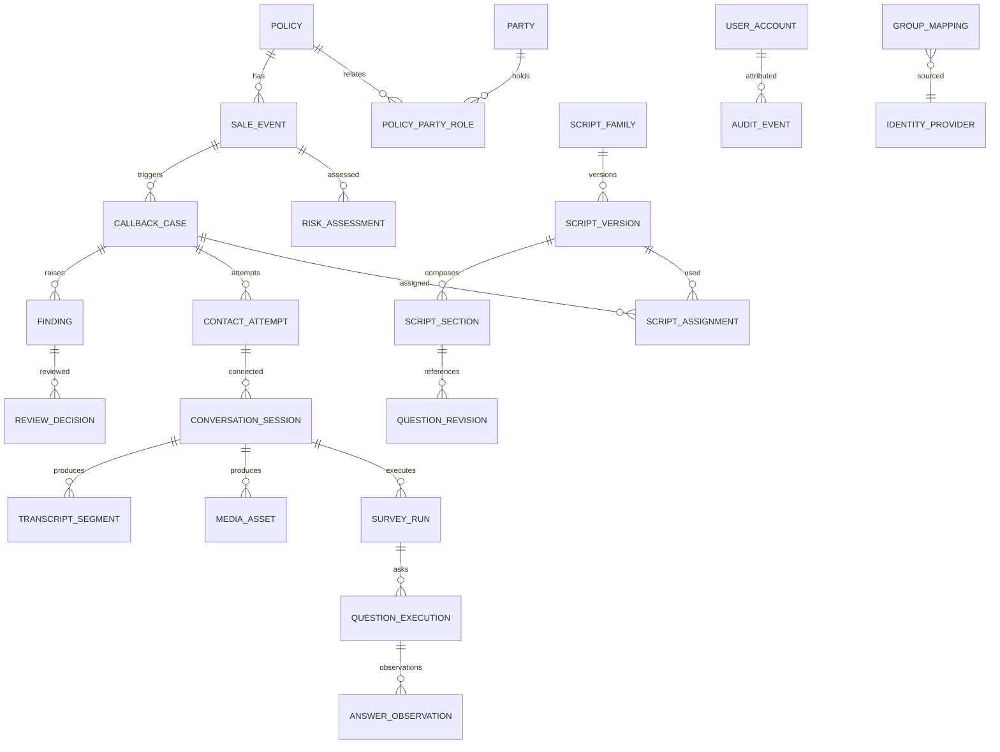

# Call360 — Canonical grain, identity, and database design

**Status:** Proposed design contract, v0.3. Actual table naming and indexing to be finalized with backend ADR before implementation. This document is authoritative on object identity and historical invariants, not a SQL migration.

> **CP0.0 note (2026-11-15):** The Stage 0 physical model is specified in `S0_DATA_MODEL.md`, which maps every S0 table to an entity below. Refinements made there without changing grain:
> - Identity tables use the security doc's names: `principal`, `identity_binding`, `local_credential`, `app_group`, `group_membership`, `group_role_mapping`, `group_scope_mapping`, `refresh_token` (C-5).
> - Case holds are a separate auditable `case_hold` record; blocking holds prevent a case from becoming callable (C-12, ADR-0008 §2).
> - `conversation_session` carries immutable pins to the script version + manifest hash, the risk assessment + snapshot hash, the policy fact snapshot + hash and the contact snapshot (D-6, ADR-0005 §4), in addition to the `survey_run` pin.
> - The script lifecycle is fixed by ADR-0007.
> - `is_synthetic` is a provenance attribute, not a permanent constraint (ADR-0008 §6).

## Canonical entity relationship view

## Table catalogue (PK is internal UUID/ULID unless noted)

| Table | Grain (exactly one row per) | Essential fields / uniqueness / relationship |
|---|---|---|
| `party` | person or organization | `party_id`, source key, masked aliases, personal-data class; do not use contact number as primary identifier |
| `contact_method` | versioned reachable method | `party_id`, channel, encrypted/masked value, priority, valid_from/to, contact restrictions, provenance |
| `policy` | issued policy / proposal identity | `policy_id`, external policy/proposal ID, market, product type, status, effective dates |
| `policy_party_role` | role assignment of a party to a policy | `(policy_id, party_id, role, valid_from)`; owner/insured/payor/proposer/eligible contact |
| `sale_event` | one distribution/sales transaction | `sale_event_id`, policy_id, FSC ID, channel/location, timestamp, product snapshot, premium; unique `(source_system, external_sale_event_id)` |
| `policy_fact_snapshot` | immutable business fact set used for a decision | source-referenced JSON, captured_at, schema version, SHA-256 digest, field provenance |
| `risk_assessment` | one decision at specific time for sale event | `sale_event_id`, kind=`CALLBACK_SELECTION`, band, source, rule_version, reason, valid_at; do not store investment tolerance here |
| `risk_factor_result` | one evaluated factor in one assessment | `assessment_id`, fact_key, fact_value/source, matched_rule_id, weight where approved, result |
| `risk_rule_set_version` | one immutable published rule-set version | author, checker, effective_from/to, checksum, status |
| `risk_override` | one requested/approved risk exception | previous assessment, proposed band, reason, maker, checker, decision and timestamp |
| `callback_case` | one verification obligation for sale + purpose | `(sale_event_id, obligation_type, source_request_ref)` unique where appropriate; eligibility/status/priority/owner/due |
| `case_contact_selection` | contact party selection for case | party role, authority and preference, source, effective timestamp, decision reason |
| `script_family` | one logical questionnaire family | code, market, description |
| `script_version` | one immutable approved questionnaire build | version, checksum, active dates, published_by, reviewer, status, language, compiled manifest |
| `script_section` | one ordered module inclusion within script version | common, product-specific, risk-specific, language; order/condition; immutable on publish |
| `question_bank_item` | one stable semantic question identity | question_key, category, control references |
| `question_revision` | one exact approved wording/answer schema revision | text, exact_mode, type, expected policy, branching, language, approval, effective status |
| `script_assignment_rule_version` | one effective-dated matching rule version | product/risk/channel/market predicate, priority/specificity, state, maker/checker, checksum |
| `script_assignment` | one script decision for case/attempt context | matched rule, competing rules, frozen script_version+hash, assigned_at/by, input snapshot; reassign leaves prior records |
| `contact_attempt` | one contact attempt event | attempt sequence, channel, selected party and method snapshot, start/end, disposition; linked case |
| `conversation_session` | one connected media segment/session | attempt_id, external model/Genesys IDs, transport, status, recording status, start/end |
| `survey_run` | one execution of frozen script within one session | session_id, script_version_id, content checksum, policy snapshot, status |
| `question_execution` | one requested/asked occurrence | survey_run, question_revision_id, order, speaker delivery status, retries, skip reason, event range |
| `answer_observation` | one raw/extracted/human-updated representation | question_execution_id, raw transcript segment IDs, typed JSON, extraction engine/version, result state, provenance, created_by, supersedes_id |
| `transcript_segment` | one source-revisioned utterance segment | time offsets, speaker, source event, raw/redacted text, time uncertainty, revision ID, checksum |
| `media_asset` | one stored audio/media artifact | session, track/source, path, content hash, coverage manifest, consent, lifecycle, retention hold |
| `compliance_rule_version` | one immutable interpretation set | approved question/control mapping, expression, effective date, digest |
| `finding` | one flagged potential concern | case_id, question_execution_id optional, severity, evidence references, origin and outcome; distinct from assessment risk |
| `review_decision` | one immutable reviewer/checker action | finding/case ID, actor, reason, timestamp, from/to status, checker reference |
| `intake_run` | one manual/API/batch ingestion attempt | source type, payload digest, actor/service identity, accepted/rejected, errors, correlation ID |
| `external_reference` | one external identifier for one entity | source_system, object_type, external_id, internal_id, immutable created_at |
| `identity_provider` | one configured IDP | local/oidc, issuer URL, status, key metadata, no embedded secrets |
| `user_account` | one durable internal staff identity | `user_id`, provider_subject, status, display name, joined/deactivated dates |
| `group_mapping` | one external group ID → local role/permission mapping | identity_provider, external_group_id, role, effective_from/to, revision/audit |
| `user_role_assignment` | one time-bound role grant | user_id, role, grant source, approver, expires_at |
| `permission` / `role_permission` | one atomic permission and assignment | e.g. `script.publish`, `call.audio.read`, `risk.override.approve`, `admin.identity.manage` |
| `auth_session` | one authenticated session | user, device/session family, created, expires, revoked, last_seen; never raw access tokens |
| `refresh_token_family` / `refresh_token_record` | one rotating family / issued refresh token hash | hash+salt/pepper per scheme, issued/expiry/used_at, reused_at, revoked_at, family ID |
| `audit_event` | one append-only meaningful action | actor_user_id OR service_principal_id, object type/id, action, old/new safe diff, reason, correlation ID, timestamp, origin, request ID |
| `regulatory_reference` / `control_mapping` | one public regulatory version / approved internal mapping | issuer, jurisdiction, version, review status, control owner, question revision links |
| `search_projection` | one authorized indexable projection (optional) | source_id, limited/redacted fields, scope, index version, retention state |

## Boundaries and constraints

1. No native policy number or customer ID used as globally unique database PK. They can be non-unique across source systems/markets and may change.
2. Denominator distinction: `COUNT(DISTINCT callback_case.id)` for coverage, attempts count for contact rate, conversation sessions for voice reliability, per-question executions for script adherence; verified outcome needs configured completion rule.
3. Require at-most-one active questionnaire run per session in the simple v1 workflow, but permit multiple sessions/attempts per case; avoid artificial 1:1 constraints with policy.
4. A finalized script/risk/answer/recording snapshot is immutable. Corrections create superseding records or attributable addenda.
5. Safe history: `created_at`, `created_by`, `updated_at`, `updated_by`, version (for mutable drafts), approved_by/approved_at where applicable, `correlation_id`; `audit_event` is independent from operational timestamp columns.
6. Denormalized search/read models can be regenerated from authoritative tables; no unauthorized material in searchable public suggestions.
7. Distinguish `source_risk_band` from `effective_callback_risk_band` if policy allows override; preserve original assessments and why the current effective one won.
8. Model appropriate market/tenant/business-unit scopes on cases, data artifacts and access control; avoid mixing distinct users with identical names.
9. Snapshot only necessary source facts; raw source payloads, if retained, have separate encrypted access and retention rules.
10. Data lifecycle: tombstones, redactions, legal holds, search index and backup cleanup must be coordinated and auditable.

## Example invariant queries (illustrative)

- Case details resolve `callback_case.sale_event_id → sale_event.policy_id → policy_party_role → party` and `risk_assessment` with `script_assignment` decision trace.
- `contact_attempt` rows show all no-answer/busy/connected outcomes. Only connected ones have `conversation_session`.
- For `question_execution Q`, display `question_revision` frozen wording, `answer_observation` raw/extracted, referenced transcript segments and rule outcome; never flatten all answers into one untraceable text blob.
- Reviewer may add `review_decision` but must not `UPDATE transcript_segment.text` or previously published script version records.
