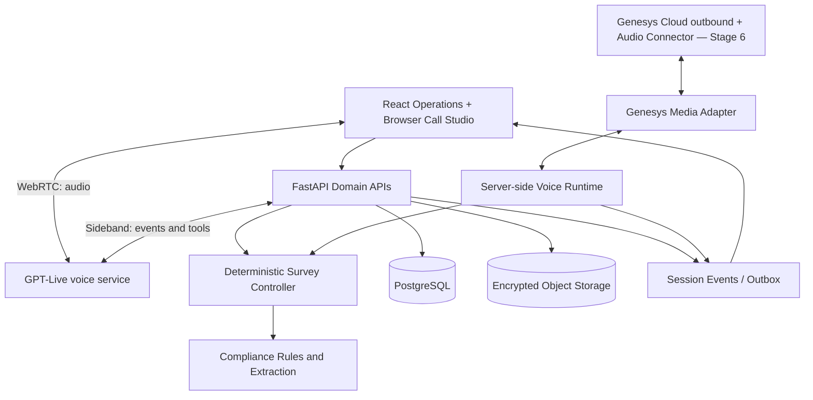

# Call360 — AIA Client Callback & Compliance Assurance Platform
## Master Business Requirements, Product Specification, and Delivery Blueprint

**Document ID:** CALL360-BRD-001  
**Status:** Proposed — requires AIA Standards & Compliance, Legal, Privacy, Security, Contact Centre, and Architecture approval  
**Version:** 0.3 | **Date:** 15 November 2026  
**Primary business owner:** AIA Standards & Compliance (S&C) — proposed  
**Delivery approach:** Browser-first, API-first, Genesys-ready, staged  
**Classification:** Working draft; use synthetic data until internal approvals are obtained.
**Repository topology:** Three independent repositories: `Call360-specs`, `Call360-backend`, `Call360-frontend`.

> **Important:** This is a proposed business and engineering specification, not a statement of AIA's existing controls or legally required script wording. Actual insurance callback scripts, identity verification, consumer notices, retention periods, access rules, escalation SLAs, and applicable market regulations must be supplied/approved by the relevant AIA control owners before production use.

---

## Product identity and UI terminology (binding)

- **Call360** (one word, capital C, no space) is the **application/product name**. Use “AIA Call360” in formal business contexts where internal brand approval permits.
- **Call Detail** is the **individual investigation screen**, covering a callback case and its attempts, sessions, recordings, transcripts, survey results, findings and audit history. The screen must not be labelled “Call 360”.
- **Call Explorer** is the searchable case/attempt/session register; **Voice Studio** is the browser test conversation experience; **Survey Studio** is the approved-script configuration experience.
- A *callback case* is not the same as an attempted call or a completed conversation. Keep object identifiers and KPI denominators distinct.
- Canonical UI route for Call Detail: `/cases/:caseId` (case-centric). Attempt/session focus is represented by query parameters such as `?attempt=<id>&session=<id>`; preserving filters/back navigation is required.
- The application naming/route contract is governed by `docs/product/SCREEN_NAMING_AND_ROUTES.md`; it applies to UI labels, accessibility names, tests, product demos and user-facing documentation. Domain object types, e.g. `CallbackCase`, are unchanged.

---

# 0. Executive decision summary

Build a **compliance operations platform with an AI voice channel**, not a chatbot with a dashboard bolted on. S&C must be able to identify and reconstruct every callback obligation, attempted contact, conversation, script version, question asked, customer response, compliance decision, reviewer action, and eventual disposition.

**Non-negotiable product properties:**

1. **A single operational surface**: global dashboard → callback case → all attempts → any conversation → synchronized transcript/recording → question results → findings → reviews → audit trail. Every drill-down must work.
2. **Script authority lives in the backend**: model-generated conversation may make the call feel natural, but it cannot authorize skipping questions, changing policy facts, granting a pass, or resolving a material discrepancy.
3. **A version is frozen per attempt**: the exact published script and rules applied to a conversation remain recoverable even if a newer survey is later published.
4. **Evidence provenance**: distinguish (a) source policy fact, (b) recognized transcript, (c) extracted answer, (d) deterministic rule outcome, (e) model suggestion, and (f) human-reviewed decision.
5. **No silent loss**: failed recording, missing transcript, incomplete answers, ambiguous identity, and disconnected calls must yield explicit statuses and alerts—not a completed/verified survey.
6. **Human accountable**: high-impact exceptions are reviewed by authorized humans. AI output is not final adjudication of customer understanding, mis-selling, or policy validity.
7. **Browser now, Genesys later**: isolate transport, audio capture, and outbound telephony. The domain API, survey engine, evidence and case workflows remain provider-neutral.
8. **Security and data minimization**: use synthetic customer records for development; prohibit uncontrolled production customer audio or data in developer environments and model providers.

## 0.1 Goals
- Reduce manual workload while preserving mandatory compliance controls.
- Ensure every in-scope policy receives a traceable callback obligation and appropriate outcome.
- Make it possible to independently audit **what was actually communicated** and why each result was assigned.
- Provide configurable, governed multilingual insurance surveys by product, market, channel and effective date.
- Give management a real-time operational picture of completed, pending, failed, breached and escalated cases.
- Support browser-based proof of value followed by scale-out to Genesys Cloud where the existing tenant/licensing permits.

## 0.2 Out of scope (unless separately approved)
- AI advice about policy suitability, recommendations, sales, premium negotiation or cancellation guidance.
- Letting the LLM independently decide regulatory compliance or close confirmed mis-selling cases.
- Calling real customers during browser development.
- Guaranteeing the customer heard audio merely because server output audio was generated or received by the browser.
- Assuming Genesys Cloud, Audio Connector licensing, or AIA-specific data interfaces until validated.
- Autonomous script creation/publishing without business approval.

## 0.3 Key success criteria
- 100% of in-scope callback cases and call attempts appear in an auditable register.
- Every completed survey has all mandatory question obligations accounted for with acceptable answers or explicit approved exception dispositions; an open material exception blocks **verified/pass**.
- Every call has a state timeline; unavailable media or transcript artifacts are visibly marked.
- A reviewer can navigate from a disputed answer to its source audio/time range and policy reference.
- Every published survey is immutable, versioned, tested, and approved; old calls retain old versions.
- All mutating case and review operations have actor/time/reason and audit event.

---

# 1. Actors, ownership, segregation of duties

| Actor | Primary capability | Restrictions |
|---|---|---|
| S&C Operations Analyst | Intake, queue triage, search, run browser test, track due cases | No script publication; no audit modification |
| S&C Reviewer | Review flags, listen to evidence, raise findings, record decisions | Cannot erase original evidence or approve own script changes |
| S&C Approver / Checker | Approve survey versions, material dispositions, closure when prescribed | Must be different identity from maker where maker-checker applies |
| Survey Maker / Product SME | Draft scripts, branch logic, product-specific expected facts, test fixtures | Cannot self-publish production version |
| Operations Manager | All-call dashboard, SLAs, staffing/queue insight, assign work | No alteration of evidence or decision logs |
| QA / Model Evaluator | Run golden tests, inspect model behavior, publish evaluation findings | No live production model/config change without approval |
| Auditor (read-only) | Search/audit exports, timelines, decision provenance | No mutations; sensitive audio access explicitly controlled |
| Platform Administrator | Tenant settings, integrations, observability, infrastructure | Does not receive unrestricted content permissions solely through admin role |
| Privacy / Legal Officer | Retention, access requests, holds, exception access | Access to restricted data through approved purpose workflow |
| System Integration Identity | Create/import cases, send telephony and model events | Least-privilege scoped service access, no user impersonation |

**Authorization:** RBAC plus object-level scope (market/business unit/campaign/product), purpose-of-access, masked default PII, and audited access to recordings. AIA Entra ID/SSO is a production integration; local development uses seeded synthetic roles and clearly marked fake identity.

---

# 2. Domain model — one view without collapsing distinct lifecycles

**Canonical object hierarchy**

```text
Customer (minimal reference)
  └─ Policy / Proposal / Product context (point-in-time snapshot)
       └─ CallbackCase (why a verification is owed; due date and final outcome)
            ├─ ContactAttempt 001 (no answer / busy / disconnected)
            ├─ ContactAttempt 002
            │    └─ ConversationSession (transport: browser or genesys)
            │         ├─ MediaAsset(s), RecordingManifest, TranscriptSegment(s)
            │         ├─ SessionEvent(s), SpeechPlaybackEvent(s)
            │         └─ SurveyRun (pinned published survey version)
            │              ├─ QuestionExecution(s), ResponseEvidence(s)
            │              ├─ ExtractedAnswer(s), RuleEvaluation(s)
            │              └─ ComplianceFinding(s)
            ├─ ReviewCase(s), Assignment(s), Escalation(s)
            └─ Disposition, FollowUpAction(s), AuditEvent(s)
```

**Never equate these:**
- `CallbackCase` ≠ `ContactAttempt`: one case may involve multiple attempts.
- `ContactAttempt` ≠ `ConversationSession`: a no-answer attempt has no spoken session.
- `ConversationSession` ≠ `SurveyRun`: interrupted or reconnected sessions may require explicit resume rules.
- `Answer` ≠ `ComplianceDecision`: extracted data is not a verdict.
- `Attempt completed` ≠ `Survey completed` ≠ `Case closed` ≠ `Compliance verified`.

**Identity/linking:** stable opaque UUIDs internally, human-readable case and call identifiers externally; model provider session IDs/Genesys conversation IDs are external correlation references, never primary keys. Each mutation carries `correlation_id`, `event_id`, actor identity, UTC timestamp and source.

---

# 3. Lifecycle and state machines

## 3.1 CallbackCase states
`CREATED → VALIDATED → READY → IN_PROGRESS → [AWAITING_CALLBACK | AWAITING_REVIEW | ESCALATED | VERIFIED | CLOSED_UNVERIFIED | CANCELLED]`

- Terminal states require mandatory reason codes and actor/approval where policy requires.
- `VERIFIED` only from a completed, evidence-sufficient, rule-approved survey and all required reviews.
- `CLOSED_UNVERIFIED` is valid for outcomes such as exhausted permitted retries, refusal, ineligible, unable to verify, or unresolved material exception; never mislabel it as pass.
- A case can be reopened by controlled workflow with full history and new versioned review record.

## 3.2 Attempt states
`SCHEDULED → INITIATED → CONNECTING → [NO_ANSWER | BUSY | WRONG_PARTY | FAILED | CONNECTED → IN_SESSION → ENDED]`.

Every attempt receives a disposition, clock times, transport, direction, explicit failure/termination reason and metadata; attempt count/retry policy is enforced at the case level.

## 3.3 Conversation and evidence states
Session: `CREATED → CONSENT_PENDING → IDENTITY_PENDING → SURVEY_ACTIVE → [PAUSED | INTERRUPTED | ESCALATING | COMPLETED | ABORTED] → FINALIZING → FINALIZED`.

Media: `NOT_REQUIRED | CAPTURE_PENDING | CAPTURING | UPLOADING | AVAILABLE | FAILED | REDACTED | PURGED | HELD`.

Transcript: `PENDING | PARTIAL | FINALIZED | QUALITY_FLAGGED | CORRECTED_BY_ADDENDUM | UNAVAILABLE`.

Survey run: `NOT_STARTED | IN_PROGRESS | PAUSED | COMPLETED | INCOMPLETE | ABORTED`.

Review: `NOT_REQUIRED | PENDING | ASSIGNED | IN_REVIEW | RETURNED | APPROVED | REJECTED | CLOSED`.

**Finalization barrier:** do not publish a final verified result until required transcript/media/evaluation commits and the rule engine confirm the evidence policy. When assets fail, set explicit `EVIDENCE_INCOMPLETE` and route for review.

## 3.4 Critical branches
- No answer / busy / voicemail / wrong person / customer unavailable / callback later.
- Identity not verified / identity refusal / consent to recording missing or withdrawn.
- Language unsupported / hearing impairment or accessibility accommodation requested.
- Customer interruption / long silence / noise / bad connection / call drops / browser tab closes.
- Customer requests clarification / skips question / answers multiple questions / refuses a question.
- Customer disputes premium term, benefits, exclusion, charges, risk or promises made by agent.
- Customer asks for person / complaint / distress / vulnerability indicators / suspected fraud.
- AI provider failure or policy guardrail failure / missing partial recording / model tool timeout.
- Multiple attempts and surveys with conflicting customer answers.

---

# 4. UX and information architecture — premium, operational, uncluttered

## 4.1 Design direction
- Enterprise-grade, visually excellent **single-page application**, not a maze of admin pages. Elegant typography, generous whitespace, strong hierarchy, subtle color; desktop-first responsive, accessible.
- Universal left navigation: **Overview | Call Explorer | Live Monitor | Work Queues | Surveys | Campaigns | Analytics | Evaluations | Administration**. Global search and contextual drill-down always visible.
- Call Detail is the **primary working surface**. Deep links preserve search filters; contextual side panel shows policy/script/alerts; never force users to jump among disconnected tabs to reconstruct a call.
- Status color is supplemented by text/icons; do not use red/green alone. PII masked by default. Empty, loading, partial, failed, delayed, and permission-denied states thoughtfully designed.
- Dense, filterable call table for experts; dashboard cards and sparklines for rapid scanning. Keyboard shortcuts, saved views, CSV exports with reason/capability controls.
- All demo data clearly labelled **SYNTHETIC / DEMO**. No invented production statistics displayed as true.

## 4.2 Screen inventory and acceptance

### UX-01 — Overview / Command Centre
**Purpose:** all callback work in one place. Header filters: date range, market, product family, survey version, team, channel, status, reviewer. Show KPIs with consistent denominators: due cases, attempted, connected, completed surveys, verified cases, awaiting review, unresolved material findings, breached SLA, retries remaining, data integrity problems. Show last 24h trend, aging buckets, risk by product, queue health, live calls, recent exceptions and actionable work items. Every metric opens the exact underlying filtered call/case list. Provide refresh and streaming update indicators; show data freshness timestamp.

### UX-02 — Call Explorer / Universal Register
Server-side pagination, sorting and advanced filtering across case, attempt, session, policy reference, masked customer name, product, campaign, agent, survey version, language, outcome, risk, call time, recording availability and reviewer. Saved filters/views. Each row has case reference, attempt count, latest call status, review status, due date, evidence quality, and audit indicators. Bulk assign is permission-controlled and audited. No client-side-only filtering of incomplete datasets.

### UX-03 — Call Detail / Single Investigation Workspace
Sticky header: case ID, survey/outcome statuses, product/policy masked, assigned reviewer, latest attempt, urgency, relevant actions. Left column: **all attempts timeline** and question navigator. Centre: **synchronized audio player and speaker-separated, time-stamped transcript**, jump-to-segment, speed, wave/progress, highlight active question, original vs amended transcript, agent/model utterances. Right column: **policy truth snapshot, survey version, extracted JSON answers, evidence pointers, rule result, exceptions and review actions**. Bottom timeline: session events, model/tool/guardrail interventions, attempts, record changes and reviewer decisions. Ability to click a finding to jump to transcript/audio, and click an answer to see extraction provenance, validator version and reviewer notes.

### UX-04 — Browser Voice Test Studio
Single clear Start / Mute / Stop UI with mic/speaker checks, selected synthetic persona/policy, approved survey version, connection health, language and voice. Live conversation transcript; current mandatory question, status, structured answer, next permitted action; a prominent **TEST MODE** banner. Display connection interruptions and graceful finish; no client API secret. Testing actions include talk over AI, silence, refusal, ambiguous answer, wrong premium term and handoff simulation. Controlled recording and explicit consent toggle for internal testers.

### UX-05 — Live Operations Monitor
Active sessions list with duration, mode, latency, network state, progress, last event timestamp, survey stage, active alerts. Drill into read-only live stream by role, with restricted audio monitoring and explicit access logging. Operator may terminate/suspend only with authorization, reason and audit event. Stale heartbeat becomes warning. Streaming updates do not overwrite persisted event history.

### UX-06 — Survey & Script Studio
Library (product, market, channel, language, effective period). Draft visual survey builder with order, mandatory flag, exact wording, answer schema, branching, approved clarifications, retry limit, expected policy facts, explanation text, recordings, consent/identity gates and termination paths. Side-by-side draft preview, JSON view, simulator, validation, diff vs previous version, submit-for-approval, publisher approval and immutable published artifact. Explicit preview of what the AI **may** say vs what it **must** say verbatim.

### UX-07 — Compliance Review Workbench
Priority queue by materiality, age, ownership and evidence status. Open any finding → exact time-bound audio/transcript, source policy snapshot, answer extraction, rules trace, similar prior answers, model-generated rationale clearly marked non-authoritative. Reviewer can confirm, reject, request more information, record controlled correction/addendum, set finding category/severity, assign follow-up, and send for checker approval. Cannot alter original evidence or unilaterally mark pass where checker is required.

### UX-08 — Campaign & Case Operations
Import/preview validated eligible cases, deduplicate by stable policy/request key, hold/exclude/suppress, set time windows and retry policies, assign survey version, simulate outcomes, launch/pause/end campaign (future real dialer). Stage 0–3 supports test cohorts and manual browser sessions; later stages support real operational scheduling.

### UX-09 — Analytics & Audit Reporting
Filterable quality/performance reporting, trend comparisons, script version performance, product/market exceptions, refusal/incorrect-knowledge rates, transcript completeness, audio integrity, reviewer turnaround, reconciliation status and model versions. Drill-down from aggregate to row evidence; download controlled signed evidence package. Reports distinguish operational outcome and compliance verdict.

### UX-10 — Administration, Privacy, Evaluation
Roles/scopes, identity/integrations, policy vocabulary, retention schedule, legal hold, model prompt/config versions, API quotas, quality thresholds, privacy cases, audit log search, health and connector settings, golden datasets and evaluation history.

## 4.3 Call Detail — reference layout

```text
+--------------------------------------------------------------------------------------+
| Case CB-10242 | Policy ••••8421 | IN REVIEW | High | Survey v3.2 | 2 attempts         |
+----------------------+-------------------------------------+-------------------------+
| ATTEMPTS + QUESTIONS | CALL PLAYER & TRANSCRIPT            | EVIDENCE + FINDINGS     |
| #1 12-Nov No Answer  | [play] 02:14 / 08:31  [speed]      | Policy truth snapshot   |
| #2 13-Nov Connected  | 00:14 AI: approved disclosure      | Q1 Identity VERIFIED    |
| Q1 Identity ✓        | 00:31 Customer: ...                 | Q2 Premium TERM CONFLICT|
| Q2 Premium !         | 01:21 AI: approved Q2 wording      | Extracted: 5 years      |
| Q3 Exclusions -      | 01:34 Customer: 'five years'       | Policy value: 10 years  |
| Q4 Final disclosure  | [click → audio 01:34]              | Rule ID RULE-PREM-04    |
|                      |                                     | [Assign] [Add review]   |
+----------------------+-------------------------------------+-------------------------+
| EVENT TIMELINE: attempt initiated → consent → Q1 → Q2 → discrepancy → human review   |
+--------------------------------------------------------------------------------------+
```

---


## 4.4 The expanded policy-sale, SBQ and script-selection experience (v0.3)

**Grain contract (binding):** `Party` is a real-world person/entity; `PolicyPartyRole` joins a party to a `Policy` with role and effective dates; `SaleEvent` is a specific selling event (not a synonym for a policy); `RiskAssessment` belongs to a `SaleEvent` or assessed verification context; `CallbackCase` is one verification obligation for a given sale and purpose; `ContactAttempt` is one effort to contact; `ConversationSession` is one connected media interaction; `SurveyRun` is one execution of a frozen `ScriptVersion`; `QuestionExecution` is a question instance in a survey run; `AnswerObservation` is one captured/extracted answer with provenance; `Finding` is a potential control discrepancy with independent disposition. A customer may own multiple policies. A policy may have multiple sale events and contact parties. A case has many attempts, possibly multiple sessions; completion denominator is cases/obligations, not attempts or answered questions.

**Three risk concepts MUST NOT be merged:** SBQ callback-selection risk (`RiskAssessment`), customer financial/investment suitability risk (a sourced policy/advice fact), and post-call compliance finding severity (`Finding`). SBQ is a provisional business term here; AIA must confirm team ownership and exact internal taxonomy.

### Proposed current-to-future process (working hypothesis, not verified AIA SOP)
1. Internal source issues proposal/policy sale and related party, FSC and channel information; source risk if available.
2. SBQ/operator evaluates sale risks (e.g. sales location/channel, premium amount, ILP classification, and other **approved** factors). Record risk band, explanation, input facts, source, effective rule version and reviewer override. No speculative regulated thresholds.
3. Determine whether a verification obligation exists; create one `CallbackCase` with eligible/authorized contact, due date, priority and ownership.
4. Select published script using jurisdiction, product family/subtype, sale channel, risk band, language and effective date; **common questions + product/risk-specific modules** compose one immutable script manifest. Conflicting rules block assignment for S&C review.
5. Human/AI calls customer, follows frozen script; record prompt delivery, response, clarifications, refusals, identity checks, interruptions and outcomes. Record partial attempts even with no completed conversation.
6. Parse typed per-question answers; compare with expected response policy and point-in-time facts; flag uncertain/wrong/missing answers, do not auto-determine mis-selling.
7. Reviewer examines recording, transcript, policy/sale context, risk reason and script version, then records human disposition and corrective action. Maker/checker where necessary.
8. Close case with explicit disposition and audit record; produce complete search and analytics across all policy/sale/call records.

### Required new UX surfaces
- **Policy Explorer** (`/policies`) and **Policy Detail** (`/policies/:policyId`): customer/owner/insured/contact party roles, FSC, sale event, source data and timestamp, selected SBQ assessment, case status, script selection and all linked calls.
- **SBQ Risk Workbench** (`/risk-assessments`): risk bands, factors, reasons, source, manual overrides and versioned risk decisions; must distinguish callback risk from customer investment risk tolerance.
- **Script Library / Script Detail** (`/scripts`, `/scripts/:scriptId`): reusable common and ILP-specific modules, question bank, expected answer schema, binding product/risk conditions, actual published versions, approval and effective periods; use `Survey Studio` as the editing environment rather than a second incompatible editor.
- **Data Intake** (`/intake`): test mock-API connector plus manual injection forms, preview/validate/dedupe/commit and import-run audit; production adapters follow the same contracts.
- **Login** (`/login`) and **Administration** (`/admin/users`, `/admin/groups`, `/admin/audit`, `/admin/config`, `/admin/integrations`): authenticated, audited, permission-protected from Stage 0; local auth provider swaps for Okta/Entra OIDC in Stage 5.
- **Global Search** (persistent app shell): search party/policy/sale/case/attempt/session, FSC, risk, script and later transcripts/findings. Search applies backend access scoping to results **and counts**; saved views, facets and deep links.
- **Call Detail enhancement**: include policy and source provenance, selected contact party, SBQ risk rationale, chosen script manifest/selection-rule trace, per-question `expected → observed → rule → evidence`, recordings, technical events, all attempts and human disposition.

### Source / manual data modes
- `MOCK_API`: deterministic local endpoints produce synthetic policy, party, sale and SBQ risk data. These are invoked via real HTTP and ingested using the same adapter/service as later enterprise connectors.
- `MANUAL`: privileged entry of synthetic data including party roles, policy/sale fields and source risk, with required user, reason, source reference, validation and history.
- `BULK`: Stage 4 CSV/JSON import and ingest queue with preview and rejected-record report.
- `INTERNAL_API`: Stage 4+ configurable provider adapter with auth, retries, canonical transform, schema version, deduplication and quarantine. No assumptions about AIA endpoints or credentials.

### Question and expected-answer business contract
An expected answer is not always a simple `YES`. Store `answer_schema`, `expected_policy` (e.g. exactly `YES`, policy-dependent numeric match, explicit acknowledgement, narrative evidence, or non-scored collection), `unacceptable_outcomes`, `not_applicable_predicate`, `evidence_required`, and `escalation_rule`. Answer states: `YES`, `NO`, `UNKNOWN`, `UNCLEAR`, `REFUSED`, `NOT_ASKED`, `NOT_APPLICABLE` plus typed values. Always retain verbatim answer and independent human review. A free-text response can trigger a finding even if its inferred yes/no matches.

### Publishing / future regulatory changes
Changes to an active script are never in-place. `DRAFT → SUBMITTED → APPROVED → SCHEDULED/PUBLISHED → SUPERSEDED/WITHDRAWN`. Adding, deleting or changing a question creates a **new published version** with stable question identity and an explicit revision. Keep all historical content, effective dates, rule snapshots and executed script checksums. Regulatory change notifications only create proposed change requests; a human Legal/S&C owner must interpret source material, validate applicability, approve exact wording and sign off the deployment.

### Security baseline (from first stage)
Local login is for **synthetic development only**. Backend must enforce RBAC, least privilege, object scope, audit, short-lived access tokens, rotated opaque refresh tokens, replay detection, secure HttpOnly cookie-based browser session and CSRF protection. Do **not** store tokens in localStorage. IdP adapter must accept OIDC Authorization Code + PKCE and configurable group-ID mapping for Okta and Microsoft Entra ID/AD later. Two base external groups `ADMIN` and `USER` are sufficient for navigation defaults but **not sufficient** for approval segregation, recording access or evidence export; use explicit fine-grained permissions and distinct checker identity. OWASP ASVS 5.0 Level 2 is the proposed verification baseline, with selected Level 3 controls and independent penetration testing for production; no software can be warranted vulnerability-free.

---

# 5. Detailed functional requirements

**Conventions:** `P0` mandatory for stated stage; `P1` important; `P2` enhancement. `S0`–`S6` delivery stages. Every row is testable; detailed scenario suites appear in sections 12 and 13. Every mutation must be authenticated, authorized and audited.

## 5.1 Platform shell, search, S&C single view

| ID | Stage/Pri | Requirement | Acceptance evidence |
|---|---|---|---|
| APP-001 | S0/P0 | One authenticated app with shared navigation and responsive shell | All defined screens reachable with persistent navigation |
| APP-002 | S0/P0 | Overview computes KPIs from database, not fake counters | Seed changes affect cards and linked result rows consistently |
| APP-003 | S0/P0 | Unified case/attempt/session register | Case with 3 attempts shows 3 attempts and exact linked sessions |
| APP-004 | S0/P0 | One-click metric → filtered register → Call Detail | Filters and source KPI denominator match |
| APP-005 | S0/P0 | Search by case ID, call ID and policy reference | Exact/partial searches return authorized records only |
| APP-006 | S0/P1 | Saved views, sortable columns and paginated search | Server results are stable across page and sort |
| APP-007 | S1/P0 | Browser session appears in Call Explorer during and after call | Same ID transitions active → finalizing → final without duplication |
| APP-008 | S4/P0 | Live operations and review queues update promptly | New attempts/alerts appear within agreed freshness SLO |
| APP-009 | S5/P0 | Metric definitions, access scopes and export audit | Every KPI has denominator, owner and data lineage |

## 5.2 Customer, policy and case intake

| ID | Stage/Pri | Requirement | Acceptance evidence |
|---|---|---|---|
| CASE-001 | S0/P0 | Synthetic customer, policy and case data model | Full case and masked policy context displayed in Call Detail |
| CASE-002 | S0/P0 | Immutable point-in-time policy fact snapshot per survey | Later policy edit does not change prior verification basis |
| CASE-003 | S4/P0 | Idempotent intake API/import, dedupe and validation | Duplicate import produces same case or explicit conflict |
| CASE-004 | S4/P0 | Eligibility, deadlines, exemptions, routing and suppression | Non-eligible cases not callable and reason is stored |
| CASE-005 | S4/P0 | Work queues, assignment, aging and configurable SLA rules | Breach timestamps and assignment history visible |
| CASE-006 | S4/P0 | Retry/scheduling policy across attempts and customer preference | Do-not-call/opt-out prevents future attempt |
| CASE-007 | S4/P1 | Resume or restart policy for incomplete survey | Never reuse unverified identity or stale policy context blindly |
| CASE-008 | S5/P0 | Closure reason taxonomy and checker rules | Verified/closed-unverified/cancelled closures are distinct |

## 5.3 Browser voice, media and session control

| ID | Stage/Pri | Requirement | Acceptance evidence |
|---|---|---|---|
| VOICE-001 | S1/P0 | Browser microphone permission, preflight and recovery | Permission denial/speaker failure clearly handled |
| VOICE-002 | S1/P0 | Secure WebRTC real-time audio without exposed provider API key | Browser source/network logs contain no master credentials |
| VOICE-003 | S1/P0 | Full-duplex audio, native VAD, turn-taking and barge-in | Human interrupts mid-speech; AI stops and responds coherently |
| VOICE-004 | S1/P0 | End, network failure, tab close and reconnect states | No orphaned open session marked completed |
| VOICE-005 | S1/P0 | Model session metadata (ID, model, config, start/end, usage) | Linked by internal session ID; model version recorded |
| VOICE-006 | S1/P0 | Client + server session event collection and reconciliation | Duplicate/replayed event cannot execute action twice |
| VOICE-007 | S1/P0 | Explicit recording consent/purpose gate per approved test policy | Denial follows no-recording/stop path; no silent capture |
| VOICE-008 | S1/P0 | Record browser input and output tracks, capture status and manifest | Download/stream the artifact; checksums match persisted metadata |
| VOICE-009 | S1/P0 | Text transcript with speaker, turn, timestamps (best effort) | Recorded transcript segment links to session and source event |
| VOICE-010 | S1/P0 | Mark gaps, dropped frames and timestamp uncertainty | Missing or incomplete evidence flagged, never silently backfilled |
| VOICE-011 | S2/P0 | Backend approves question progression / speech modes | Model cannot mark mandatory question complete independently |
| VOICE-012 | S2/P0 | Exact approved wording for mandatory disclosures/questions | Verbatim delivery via controlled audio/TTS path or explicitly fails gate |
| VOICE-013 | S3/P0 | Independent transcript review/quality scoring for material evidence | Numeric/policy terms validated, uncertainty flagged |
| VOICE-014 | S5/P1 | Session/voice latency, interruption and outage telemetry | p50/p95 displayed by provider, version and network mode |
| VOICE-015 | S6/P0 | Genesys media adapter independent of survey logic | Same survey engine used in browser and Genesys test calls |

**Audio evidence warning:** A server-side copy of synthesized audio is **not** proof it was played or heard. Store generated/received/queued/played events separately; browser playback telemetry is not absolute proof of perception. For high-assurance production evidence, define with S&C and Genesys authoritative recording/reconciliation requirements.

## 5.4 Survey governance and execution

| ID | Stage/Pri | Requirement | Acceptance evidence |
|---|---|---|---|
| SUR-001 | S0/P0 | Define survey/versions, question, branching and schema entities | Seed survey renders question navigator and metadata |
| SUR-002 | S2/P0 | Survey library and visual builder | Maker drafts, edits order, text, type, validation and branches |
| SUR-003 | S2/P0 | Per-question mandatory flag, prerequisites and allowable retries | Invalid config cannot be published; required Q cannot be skipped |
| SUR-004 | S2/P0 | Approved exact wording, clarifications, language variants | Version defines allowed speech mode and fallback |
| SUR-005 | S2/P0 | Typed structured response schema and source policy binding | Required fields and types validated by Pydantic + JSON Schema |
| SUR-006 | S2/P0 | Draft/validation/simulation/submitted/approved/published/retired lifecycle | Maker cannot publish own survey; every change has diff and author |
| SUR-007 | S2/P0 | Immutable published surveys and effective dating | Existing call pinned to version; changes require new version |
| SUR-008 | S2/P0 | Deterministic next question/branching server-side | LLM cannot choose unauthorized next question |
| SUR-009 | S2/P0 | Identity, disclosure, consent and closing gates configurable | Policy facts never spoken before approved identity gate |
| SUR-010 | S2/P0 | Survey simulator with synthetic persona scripts | Maker sees all paths, mandatory coverage, expected outcomes |
| SUR-011 | S3/P0 | Question execution ledger: requested, generated, delivered, answered | Each obligation has explicit state and provenance |
| SUR-012 | S5/P0 | Static validations and regression/golden test gate before publish | Failed critical scenarios block publish |
| SUR-013 | S5/P1 | Multi-market/localization ownership and translation approval | No unreviewed translation in published script |

## 5.5 Answers, compliance rules and structured results

| ID | Stage/Pri | Requirement | Acceptance evidence |
|---|---|---|---|
| COMP-001 | S2/P0 | Capture original customer utterance separately from interpretation | Raw transcript and extracted value shown side-by-side |
| COMP-002 | S3/P0 | Structured extraction with schema validation, abstain/unknown | Ambiguous response saved as UNKNOWN, not inferred pass |
| COMP-003 | S3/P0 | Deterministic rule engine compares policy facts and answers | 5-year answer vs 10-year term produces policy discrepancy |
| COMP-004 | S3/P0 | Evidence link to transcript segment/time range and media asset | Clicking result jumps to exact supporting segment |
| COMP-005 | S3/P0 | Rule version, evaluator model, prompt version and extraction provenance | Re-run with different version creates new evaluation, preserves old |
| COMP-006 | S3/P0 | Explicit statuses PASS/FAIL/UNCLEAR/NOT_ASKED/NOT_APPLICABLE | No mapping of uncertainty/missing data to PASS |
| COMP-007 | S3/P0 | Final decision matrix with blocking severity and evidence completeness | Critical unresolved flag cannot yield VERIFIED |
| COMP-008 | S3/P0 | Generate separate findings and remediation tasks | Each finding has owner, severity, category, SLA and disposition |
| COMP-009 | S3/P0 | Human override only as signed addendum with reason and policy | Original AI result immutable; new reviewer decision referenced |
| COMP-010 | S3/P0 | Prohibit unsupported product claims and sales advice | Guardrail/evaluation suite confirms no permitted off-script claim |
| COMP-011 | S3/P0 | Cross-question and cross-attempt contradiction detection | Contradictory statements flagged, not silently reconciled |
| COMP-012 | S5/P0 | Ground truth evaluation and calibrated confidence/abstention | Reviewer adjudicated labels; critical false-negatives tracked |

## 5.6 Recording, transcript, artifact and audit evidence

| ID | Stage/Pri | Requirement | Acceptance evidence |
|---|---|---|---|
| EVD-001 | S1/P0 | Store media outside transactional DB; metadata in database | Call Detail plays from authorized object reference |
| EVD-002 | S1/P0 | Session event ledger; ordered events, timestamps and actor/source | Replay reconstructs visible timeline and states |
| EVD-003 | S1/P0 | Recording manifest: source, start/end, codec, checksum, gaps, consent | Artifact integrity validated; unavailable status visible |
| EVD-004 | S1/P0 | Persist partial/final transcripts and transcript revision provenance | User sees final and original without overwrite |
| EVD-005 | S3/P0 | Time-bound evidence references for findings and extracted answers | No finding may reference a nonexistent segment |
| EVD-006 | S3/P0 | Structured output stored as versioned JSON plus searchable typed fields | Full original JSON retained and key fields queryable |
| EVD-007 | S3/P0 | Evidence bundle export with manifest + permitted artifacts + hashes | Re-import or independent verification detects missing/changed files |
| EVD-008 | S5/P0 | Append-only audit events; DB write restrictions | Nonprivileged roles cannot edit/delete history |
| EVD-009 | S5/P0 | Recording retention, deletion, holds and disclosure controls | Retention job honors holds; deletion audit is retained as permitted |
| EVD-010 | S5/P0 | Record content access (listen/download/export) with reason | Security review can enumerate all user accesses |
| EVD-011 | S5/P0 | Encrypt and restrict media, logs, backups and export | Private, time-limited links only; no public blob URL |
| EVD-012 | S5/P0 | Quality reconciliation of session, transcript, media and findings | Broken/incomplete evidence creates blocking data integrity incident |

## 5.7 Review, escalation, human handoff and closure

| ID | Stage/Pri | Requirement | Acceptance evidence |
|---|---|---|---|
| REV-001 | S3/P0 | Priority review queue with assignment and aging | Exception arrives with owner, time, severity and due target |
| REV-002 | S3/P0 | Reviewer evidence player and structured decision capture | Evidence jump works; signed reason required |
| REV-003 | S3/P0 | Escalation reasons: mis-selling concern, complaint, human request, fraud etc. | Reason-coded escalation prevents automated verified outcome |
| REV-004 | S3/P0 | Maker/checker approval for specified outcome categories | Same actor cannot both decide and approve protected outcome |
| REV-005 | S4/P0 | Follow-up actions with due dates, notifications and escalations | Outstanding actions visible from case and queue |
| REV-006 | S4/P0 | Callback reschedule, refusal, lost contact and retry exhaustion | Correct non-verified closure reason and history |
| REV-007 | S5/P0 | Controlled reviewer correction and appeal/reopen | Immutable decision trail; prior closure never erased |
| REV-008 | S6/P0 | Transfer/handoff metadata to Genesys Architect/human queue | Transfer event and subsequent ownership are traceable |

## 5.8 Campaigns, workload and operational analytics

| ID | Stage/Pri | Requirement | Acceptance evidence |
|---|---|---|---|
| OPS-001 | S4/P0 | Campaign with product, survey version, segment, schedule and capacity | Each case links to campaign/version and policy |
| OPS-002 | S4/P0 | Contact policies: windows, attempts, opt-out, do-not-call and priority | Restricted cases cannot be re-contacted |
| OPS-003 | S4/P0 | Dashboard operational and compliance KPIs separately | Denominators and disposition categories published and reproducible |
| OPS-004 | S4/P0 | Real-time call/session health and stale-stream handling | Disconnected session alerted without phantom active status |
| OPS-005 | S4/P0 | Failure work queue for finalization, media and integrations | Retries idempotent; permanently failed job visible |
| OPS-006 | S4/P1 | Scheduled PDF/CSV reports and controlled email distribution | Export contains scope metadata; export action logged |
| OPS-007 | S5/P0 | SLOs/alerts for provider latency, recording gaps, evidence backlogs | Incident has owner, severity, resolved time |
| OPS-008 | S6/P0 | Genesys outbound campaign/disposition synchronization | Provider events reconciled without duplicated attempts |

## 5.9 Security, privacy, governance, integrations

| ID | Stage/Pri | Requirement | Acceptance evidence |
|---|---|---|---|
| GOV-001 | S0/P0 | Synthetic-only local data, safe secrets and no production credentials | Test environment cannot access real customer imports by default |
| GOV-002 | S0/P0 | API authentication and permission scaffolding even in demo mode | Protected endpoints reject unauthorized use |
| GOV-003 | S1/P0 | Provider key never reaches browser | Secrets scan and browser audit pass |
| GOV-004 | S2/P0 | Versioned prompts, config, audio instructions and rules | Every survey session pins complete effective config manifest |
| GOV-005 | S5/P0 | Entra SSO, role/scope policies and least privilege | Cross-role and cross-market access tests pass |
| GOV-006 | S5/P0 | PII classification, masking, purpose limitation and redacted logs | Analytics/logs contain no unapproved sensitive customer content |
| GOV-007 | S5/P0 | Legal/privacy signoff for notice, consent, processing, providers, retention | Approval record and operational runbook exist |
| GOV-008 | S5/P0 | Data residency/provider terms, subprocessors, training-data treatment | Security/DPIA signoff before production customer data |
| GOV-009 | S5/P0 | Threat modeling, pen test, vulnerability handling and incident response | No unresolved critical findings at launch gate |
| GOV-010 | S5/P0 | Backup/restore, disaster recovery, retention and secure purge | Restore test proves evidence/relational consistency |
| GOV-011 | S5/P0 | Replay-safe idempotent events; reconciliation/audit monitoring | Duplicate callback, tool execution or session close prevented |
| GOV-012 | S5/P0 | AI model evaluation, change management and rollback | Gate fails and rollback possible on degraded critical regression |
| GOV-013 | S6/P0 | Genesys Cloud feature/license/config verification and integration security | Connected in non-production tenant with approved routing |
| GOV-014 | S6/P0 | Provider adapter architecture and no domain leakage | Replacing transport does not alter survey state machine |

---


## 5.11 Expanded policy-sale, risk, script, intake, identity, security and search requirements (v0.3)

These rows extend, without renumbering, all original 99 requirements. Linked detailed process, design and security contracts are in `docs/product/`, `docs/engineering/` and `docs/contracts/`.

### 5.11.1 — PARTY requirements

| ID | Stage/Pri | Requirement | Acceptance evidence |
|---|---|---|---|
| PARTY-001 | S0/P0 | Represent distinct policy owner, insured person, payer, proposer, beneficiary and authorized callback contact roles | Multiple parties and role edges shown without duplicating a person |
| PARTY-002 | S0/P0 | Persist stable source customer/party references and independent contact IDs | One party can have many policy role relationships |
| PARTY-003 | S0/P0 | Maintain effective-dated contact methods, verification preference, language, timezone and consent/suppression flags | Changed number does not overwrite earlier call contact snapshot |
| PARTY-004 | S0/P0 | Select eligible callback contact using policy-configured relationship and authority checks | Ineligible contact is blocked with explicit reason |
| PARTY-005 | S0/P0 | Display masked party and contact cards in Policy Detail and Call Detail | Role and contact relationship always visible with masking |
| PARTY-006 | S1/P0 | Pin contacted party and authorized identity-verification state to each session | Session cannot pass if identity outcome is missing or failed |
| PARTY-007 | S3/P0 | Separate respondent speech from owner/insured assertions in structured evidence | Answer records respondent party reference and identity outcome |
| PARTY-008 | S4/P0 | Record failed contact details and approved manual corrections with provenance | Manual correction preserves before/after, actor and source |
| PARTY-009 | S4/P1 | Support multiple possible contacts with ordered selection and do-not-contact overrides | Retry uses only eligible contact and approved windows |
| PARTY-010 | S5/P0 | Enforce field-level access for contacts and special categories | Unauthorized API search/export cannot return unmasked details |

### 5.11.2 — POL requirements

| ID | Stage/Pri | Requirement | Acceptance evidence |
|---|---|---|---|
| POL-001 | S0/P0 | Model policy and individual sale/transaction event separately | One policy may contain initial sale plus replacement/top-up events |
| POL-002 | S0/P0 | Persist product family, subtype including ILP, premium amount/currency/frequency, sum assured and policy effective dates | Product detail reflects typed source-backed fields |
| POL-003 | S0/P0 | Capture selling channel, location, campaign and FSC/representative reference for sale event | Sale context persists regardless of later agent assignment changes |
| POL-004 | S0/P0 | Create policy detail workspace with party relationships, sale context and callback cases | Policy Detail deep links to risk and call timeline |
| POL-005 | S0/P0 | Store validated source provenance, retrieval timestamp, external IDs and raw payload reference for imported policy fields | Every displayed material field has source and as-of date |
| POL-006 | S0/P0 | Freeze point-in-time fact snapshot used for script selection and answer evaluation | Later policy update never silently changes prior evaluation |
| POL-007 | S0/P0 | Allow authorized manual entry/edit of synthetic policy, sale and party data with reason | Created_by, changed_by, source and diff available |
| POL-008 | S4/P0 | Reconcile policy updates against open cases using explicit re-assessment workflow | Potentially stale case is flagged and not silently rewritten |
| POL-009 | S4/P0 | Block accidental duplicate sale event ingestion with source-system plus source-event unique keys | Repeated message remains one sale event |
| POL-010 | S4/P1 | Support policy status change events, cancellations and sale corrections | Appropriate holds/reviews triggered without erasing history |
| POL-011 | S4/P1 | Support proposal reference before policy issuance and post-issue linkage | Case remains traceable across proposal-to-policy transition |
| POL-012 | S5/P0 | Scope policy reads and exports by market, team, assignment and purpose | Cross-scope access denied on backend endpoints |

### 5.11.3 — RISK requirements

| ID | Stage/Pri | Requirement | Acceptance evidence |
|---|---|---|---|
| RISK-001 | S0/P0 | Represent SBQ callback-selection risk independently of financial investment risk tolerance and post-call finding severity | Three distinct schemas, labels and reports |
| RISK-002 | S0/P0 | Persist assigned band, assessment date, reason codes, source system and original source value | Risk card displays band, reason and provenance |
| RISK-003 | S0/P0 | Store risk factors as typed values with evaluation snapshot and evaluation version | Prior assessment reproducible with original values |
| RISK-004 | S0/P0 | Support seeded source-assigned risk and local rule-assessed risk in synthetic dataset | User can distinguish assessed vs supplied rating |
| RISK-005 | S0/P0 | Show risk summary on policy detail, case intake and Call Detail | Each case shows assessment version and origin |
| RISK-006 | S0/P0 | Provide configurable risk-factor vocabulary for channel, selling location, premium thresholds, ILP/product class and other approved factors | Risk screen shows human-readable factors and no hardcoded legal thresholds |
| RISK-007 | S2/P0 | Version risk-selection rules with author/checker, validation, effective period and change reason | No silent edits to published risk rule sets |
| RISK-008 | S2/P0 | Deterministically calculate candidate callback risk based on approved factor rules | Unit fixture returns matched rule IDs and result |
| RISK-009 | S2/P0 | Set conflict policy for upstream risk versus calculated risk including precedence and escalation | Conflicting risk becomes visible exception, not overwritten |
| RISK-010 | S2/P0 | Permit authorized risk overrides with justification and independent approval where required | Audit shows original, override, actor and checker |
| RISK-011 | S2/P0 | Use risk assessment snapshot as an input to script assignment and work priority | Assignment explanation includes matched factors |
| RISK-012 | S4/P0 | Receive risk assessments from mock upstream risk API with idempotency and validation | Repeated payload does not create extra assessments |
| RISK-013 | S4/P1 | Support risk recalculation requests after upstream policy updates | Reassessment creates new version and flags impacted cases |
| RISK-014 | S5/P0 | Evaluate risk factor selection for fairness, unnecessary sensitive data and false escalation | Governance review documented before activating new factors |

### 5.11.4 — SCR requirements

| ID | Stage/Pri | Requirement | Acceptance evidence |
|---|---|---|---|
| SCR-001 | S0/P0 | Represent script family, script version, sections, reusable question references and immutable publication manifest | Seed script shows ordered common and ILP-specific questions |
| SCR-002 | S0/P0 | Represent expected-answer semantics: expected category, acceptable variants, policy-field match and disallowed outcomes | Yes is not automatically considered compliant in every question |
| SCR-003 | S0/P0 | Provide Script Library search/filter by product, risk, sales channel, status and effective date | Can locate published versus draft revisions |
| SCR-004 | S0/P0 | Display assigned script name, exact version, rationale and selection rule in case and Call Detail | Re-opened historic case retains assigned version |
| SCR-005 | S0/P0 | Create deterministic seeded script assignment examples common core plus ILP module | ILP sample resolves both common and ILP sections |
| SCR-006 | S1/P0 | Freeze published script version and approved question set at session creation | A later publish cannot change running session requirements |
| SCR-007 | S2/P0 | Create question bank with stable question key, revision, category and approved languages | Changed text results in revision without mutating historical version |
| SCR-008 | S2/P0 | Support question types yes/no/unclear/refused, number, choice, date and verbatim narrative | Answer capture and validation operate on schema |
| SCR-009 | S2/P0 | Support scripted follow-ups, definitions, approved clarifications and repetition ceilings | No unapproved explanation generated for mandatory disclosure |
| SCR-010 | S2/P0 | Support conditional/mandatory sections based on product, ILP, customer role, risk band and channel | Explicit path trace produced by simulator |
| SCR-011 | S2/P0 | Support weighted rule precedence with conflicts, specificity, effective dates and default fallback | Ambiguous assignment is blocked and flagged |
| SCR-012 | S2/P0 | Provide visual script editor with reorder, add, retire, branch and dependency validation | Safe preview; unresolved dangling branch prevents submit |
| SCR-013 | S2/P0 | Enforce draft, submitted, approved, scheduled, published, superseded and withdrawn statuses | Published versions immutable and reproducible |
| SCR-014 | S2/P0 | Enforce independent maker/checker approval with reason, impact summary and role authorization | Maker cannot approve own revision |
| SCR-015 | S2/P0 | Support semantic/version diffs, change notes and regulatory change mapping | Reviewer sees added/deleted/moved/changed questions |
| SCR-016 | S2/P0 | Support future-dated activation, retirement and rollback to an earlier approved version via new controlled publication | Historical sessions retain exact version and checksums |
| SCR-017 | S2/P0 | Run regression simulator against synthetic risk/product/customer profiles before publishing | Coverage includes default/high-risk/ILP and edge cases |
| SCR-018 | S2/P0 | Distinguish regulatory source, AIA policy interpretation and internal approved script requirement | No unreviewed MAS text becomes automatically executable |
| SCR-019 | S2/P0 | Define exact-audio/controlled-TTS versus conversational mode for each question and disclosure | Verbatim-required items cannot rely on prompt alone |
| SCR-020 | S3/P0 | Persist per-question actual utterance, delivery state, structured answer, assessment and evidence | Expected answer and observed answer both visible |
| SCR-021 | S3/P0 | Allow human correction as versioned annotation with original machine result preserved | Reviewer adjustment never changes raw speech evidence |
| SCR-022 | S4/P1 | Support impact analysis of script changes on open cases, queued cases and cohorts | Impact report and migration options shown before activation |

### 5.11.5 — ING requirements

| ID | Stage/Pri | Requirement | Acceptance evidence |
|---|---|---|---|
| ING-001 | S0/P0 | Provide mock Policy System API and mock Risk/SBQ API returning versioned synthetic payloads | Local HTTP fixture produces realistic deterministic responses |
| ING-002 | S0/P0 | Provide authorized manual injection for customer, party, policy, sale and source-risk records | User can submit valid test case through UI and API |
| ING-003 | S0/P0 | Require source_type and source_reference for all ingested entities including manual | Provenance cannot be empty |
| ING-004 | S0/P0 | Support validation errors and preview before manual import commit | Invalid role, product or policy fields rejected with details |
| ING-005 | S4/P0 | Support bulk CSV/JSON import and API intake with preview, dry run and row-level errors | 100-record batch produces accepted/rejected totals |
| ING-006 | S4/P0 | Use typed connector interfaces for mock/internal systems with versioned API contracts | Switch to real adapter without changing policy domain services |
| ING-007 | S4/P0 | Implement external source identifiers, idempotency keys, retries, backoff and dead-letter review | Duplicate upstream events do not duplicate callback cases |
| ING-008 | S4/P0 | Classify upstream values as authoritative, advisory or manually overridable | Field-level conflict treatment documented and tested |
| ING-009 | S4/P0 | Provide ingestion runs dashboard with status, payload trace, checksum, actor and correction workflow | Failed import is visible and replayable without data loss |
| ING-010 | S4/P0 | Validate contact consent/suppression and contact eligibility before creating callable work | Suppression or missing authority creates hold |
| ING-011 | S5/P0 | Secure service-to-service ingest with scoped client credentials, mTLS/private network where required | Untrusted caller cannot inject policy/risk facts |

### 5.11.6 — SEARCH requirements

| ID | Stage/Pri | Requirement | Acceptance evidence |
|---|---|---|---|
| SEARCH-001 | S0/P0 | Create global search over case ID, policy reference, customer alias, agent/FSC reference and sale event | Authorized user can find each type from one search box |
| SEARCH-002 | S0/P0 | Provide faceted Call Explorer for product, ILP, risk, channel, FSC, owner, status, date and script version | Filters combine and are URL-shareable |
| SEARCH-003 | S0/P0 | Support exact-match normalized IDs, prefix lookup, controlled fuzzy name and date ranges | Consistent ranking with explanation of matched field |
| SEARCH-004 | S0/P0 | Provide saved query/filter views for each user, without cross-user leakage | User-specific saved view round-trip works |
| SEARCH-005 | S0/P0 | Support sort and cursor-based pagination with deterministic order | No missing or duplicated rows across pages |
| SEARCH-006 | S0/P0 | All search APIs enforce object/field authorization before results, counts and suggestions | Unauthorized existence cannot be inferred from counts |
| SEARCH-007 | S0/P0 | Return structured empty/error/loading states and quick navigation to Policy Detail and Call Detail | All results carry typed navigation route |
| SEARCH-008 | S3/P0 | Search structured answers, question IDs and findings with evidence-linked drilldown | Question search opens precise question and audio interval |
| SEARCH-009 | S3/P1 | Search transcript text only for roles with explicit transcript-search permission | No raw sensitive transcript leakage in suggestion responses |
| SEARCH-010 | S4/P0 | Index ingestion records, script revisions, risk assessments and user/system audit actions | Admin finds change by actor/date/object |
| SEARCH-011 | S4/P0 | Support export of filtered authorized search results with reason and audit | Masked data by default; export approval enforced |
| SEARCH-012 | S4/P1 | Support saved team views and configurable column chooser | Team view honors each viewer access scope |
| SEARCH-013 | S5/P0 | Apply retention, legal hold and redaction to indexed copies, caches and backups per policy | Erased source stops appearing in search after reconciliation |
| SEARCH-014 | S5/P0 | Implement rate limits, bounded queries, query timeouts and anti-enumeration safeguards | Adversarial broad and sequential lookup tests pass |

### 5.11.7 — IAM requirements

| ID | Stage/Pri | Requirement | Acceptance evidence |
|---|---|---|---|
| IAM-001 | S0/P0 | Deliver dedicated login, logout, session status and unauthorized screens | Unauthenticated app routes redirect and API returns 401 |
| IAM-002 | S0/P0 | Local demo identity provider with seeded admin/user accounts stored safely and isolated from production | Local credentials never committed; demo-only banner present |
| IAM-003 | S0/P0 | Persist immutable internal subject ID and current provider-linked identity metadata | Provider change preserves internal actor history |
| IAM-004 | S0/P0 | Implement users, roles, permissions, groups, memberships and group-to-role mappings | Admin and User group membership yields correct base role |
| IAM-005 | S0/P0 | Enforce backend authorization on every endpoint and object, including downloaded media | UI hiding a control cannot bypass backend checks |
| IAM-006 | S0/P0 | Issue short-lived audience-scoped access tokens with algorithm/key/issuer/expiration validation | Expired, wrong audience, tampered tokens rejected |
| IAM-007 | S0/P0 | Issue opaque rotating refresh tokens, store only hashes and detect reuse/replay | Old refresh reuse revokes active token family |
| IAM-008 | S0/P0 | Use secure HttpOnly SameSite cookies for browser session with CSRF protection; no localStorage token persistence | Browser tests show no tokens in localStorage or URL |
| IAM-009 | S0/P0 | Implement explicit logout, session revocation, inactive account and role/group change invalidation | Revoked session and refresh fail immediately or within approved bound |
| IAM-010 | S0/P0 | Provide Admin Users & Groups screen for enable/disable, membership view and auditable changes | Only admin may mutate groups; before/after recorded |
| IAM-011 | S0/P0 | Record login success/failure, admin login attempts, token reuse and access-denied audit without logging secrets | Security event has actor/session/IP metadata and outcome |
| IAM-012 | S2/P0 | Support script publisher/checker action permissions beyond two base UI groups | Admin cannot self-approve their own script change |
| IAM-013 | S3/P0 | Support scoped reviewer, audio-view and evidence-export permissions | User cannot hear call merely through guessing media URL |
| IAM-014 | S5/P0 | Implement standards-based OIDC Authorization Code + PKCE federation for Okta or Entra ID | Staging IdP login works with issuer/audience/signature checks |
| IAM-015 | S5/P0 | Map external AD/Okta group IDs via configured mapping, deny unknown users by default | Group remapping auditable, deprovisioning enforced |
| IAM-016 | S5/P0 | Require corporate MFA and step-up for privileged operations through IdP where prescribed | MFA claim/access policy validated before privileged operation |
| IAM-017 | S5/P0 | Create emergency/break-glass access with approval, time limit, alert and audit | Emergency session expires and is reviewed |
| IAM-018 | S5/P0 | Separate service identities from human identities and restrict tokens to API scopes | Service token cannot log in as S&C reviewer |

### 5.11.8 — SEC requirements

| ID | Stage/Pri | Requirement | Acceptance evidence |
|---|---|---|---|
| SEC-001 | S0/P0 | Threat model for identity, policy PII, audio, transcript, script change, integration and admin operations | STRIDE threats linked to mitigations and tests |
| SEC-002 | S0/P0 | Enforce secure-by-default backend validation, strict schemas and parameterized queries | SQL injection and unexpected fields rejected |
| SEC-003 | S0/P0 | Default-deny CORS, robust CSRF, CSP and security headers for browser application | Cross-origin and cross-site request tests denied |
| SEC-004 | S0/P0 | Enforce permissions per route, record, attachment and search result | BOLA/IDOR test cases are denied |
| SEC-005 | S0/P0 | Keep provider and signing secrets in local environment or approved secret store, never browser or git | Secret scanning checks pass |
| SEC-006 | S0/P0 | Rate-limit login, token refresh, write APIs and search queries | Brute-force and enumeration tests throttled |
| SEC-007 | S0/P0 | Protect audit trail with append-only records, actor identity, correlation IDs and immutable original content | Admin edits leave attributable immutable audit event |
| SEC-008 | S0/P0 | Establish secure development baseline using OWASP ASVS 5.0 Level 2 and risk-selected Level 3 controls | Control-to-test matrix and remediation owner documented |
| SEC-009 | S1/P0 | Scope realtime voice credentials to one authorized ephemeral session | Session token cannot read or join other case |
| SEC-010 | S1/P0 | Restrict recording upload object keys and verify checksums/media type/size | Arbitrary object overwrite and traversal fail |
| SEC-011 | S2/P0 | Treat prompt and script configuration as untrusted input; enforce tool allowlist and controller authorization | Prompt injection cannot skip mandatory script |
| SEC-012 | S3/P0 | Encrypt stored media/PII at rest and in transit with approved key governance | Storage and signed download tests pass |
| SEC-013 | S3/P0 | Log recording/transcript access, bulk download, privilege changes and checker actions | Audit provides purpose, actor and scope |
| SEC-014 | S4/P0 | Secure data ingestion via schema, source authentication and replay protection | Forged and duplicated imports rejected |
| SEC-015 | S5/P0 | Implement SAST/SCA/secrets/DAST, supply-chain SBOM and signed release evidence | Critical findings triaged and release-gated |
| SEC-016 | S5/P0 | Conduct independent penetration testing and tracked remediation before production | Accepted risk register and retest evidence |
| SEC-017 | S5/P0 | Verify backup restore, disaster recovery, retention and legal hold operation | Restoration and legal hold acceptance tests recorded |

### 5.11.9 — REG requirements

| ID | Stage/Pri | Requirement | Acceptance evidence |
|---|---|---|---|
| REG-001 | S0/P0 | Provide regulatory-reference register with source, jurisdiction, document version and internal interpretation status | Reference does not imply a mandatory callback question until approved |
| REG-002 | S0/P0 | Link proposed questions to policy controls and optionally to public MAS guidance | Question detail distinguishes legal source from AIA control |
| REG-003 | S2/P0 | Support regulatory change proposals and impact assessment to affected scripts/risk rules | Proposed MAS change produces traceable work item |
| REG-004 | S2/P0 | Require Legal/S&C approval before new regulatory interpretation changes published scripts | Unapproved change cannot publish |
| REG-005 | S2/P0 | Record effective-from, effective-to and jurisdiction for script/regulatory mapping | Historic call maps to historical rule basis |
| REG-006 | S2/P0 | Support controlled question removal/retirement while retaining previous active copies | Old survey executions resolve original question wording |
| REG-007 | S3/P0 | Link compliance findings to approved control basis and question revision | Reviewer can inspect control version at call time |
| REG-008 | S4/P1 | Create change impact dashboard by open cases, products and scripts | Cases needing re-assignment visible |
| REG-009 | S5/P0 | Require documented privacy/legal assessment of call recording and model data before go-live | Approval artifacts stored and linked to release |
| REG-010 | S5/P0 | Review scripts and risk factors periodically with due date and attestation | Overdue review alerts and auditable sign-off |

### 5.11.10 — ADMIN requirements

| ID | Stage/Pri | Requirement | Acceptance evidence |
|---|---|---|---|
| ADMIN-001 | S0/P0 | Provide admin dashboard for users, groups, memberships, audit events and feature settings | Admin sees meaningful persistence-backed management UI |
| ADMIN-002 | S0/P0 | Provide full change history for user, script, rules, risk, policy and integration configuration | Who/when/old/new/reason/query origin retrievable |
| ADMIN-003 | S0/P0 | Separate configuration edit and publish/approve permissions from system-administration status | Admin cannot bypass required independent approval |
| ADMIN-004 | S0/P0 | Provide configuration catalogue for value lists and feature toggles with versioned changes | Prior code-list values remain explainable historically |
| ADMIN-005 | S2/P0 | Provide script approval inbox, reviewer comments and maker-checker history | Approve/reject actions attributed and immutable |
| ADMIN-006 | S2/P0 | Provide risk and script mapping rule administration with test preview | Rule change displays matched example cases |
| ADMIN-007 | S4/P0 | Provide integration endpoints, health, ingest schedules and provider mapping configuration | Admin can diagnose mock source failures |
| ADMIN-008 | S4/P0 | Provide search and export over admin audit events with restricted permissions | Authorized auditor can trace any script change |
| ADMIN-009 | S5/P0 | Support managed IdP settings, group mapping and access recertification | No unchecked automatic role elevation |
| ADMIN-010 | S5/P0 | Support key rotation, session kill, data retention jobs and security alerts | Admin operations auditable and dual-controlled if high impact |

# 6. Survey & script configuration specification

## 6.1 Fields for the survey artifact
- `survey_id`, `version`, `status`, `effective_from/to`, `market`, `product_family`, `language`, `owner`, `approval_chain`, `content_sha256`.
- `identity_gate`, `recording_notice`, `consent_gate`, `privacy_notice`, `customer_refusal_path`, `human_escalation_policy`.
- `questions[]`: stable `question_id`, order, parent/branch, `required`, `display_text`, `approved_spoken_text`, `delivery_mode` (`EXACT_AUDIO`, `CONTROLLED_TTS`, `CONVERSATIONAL`), `answer_schema`, `timeout`, `max_reprompts`, `allowed_clarification_ids`, `expected_policy_field`, `validation_rule_ids`, `next_question_rules`, `skip_condition`, `risk_level`.
- `clarifications[]`: stable ID, exact approved wording, allowed trigger, maximum use count, localized translation approvals.
- `rules[]`: stable/versioned rule references, deterministic predicates, severity, blocking flag, review routing.
- `closing_messages[]`, `escalation_messages[]`, survey-level `completion_policy` and source references.

## 6.2 Approval lifecycle
`DRAFT → VALIDATION_FAILED/VALIDATED → SUBMITTED → APPROVED → PUBLISHED → RETIRED`.
Only draft may be edited. Publishing copies to a content-addressed immutable artifact, records maker/approver/time/checksum, freezes references (including audio assets and translations), and records activation date. New published version does not retroactively change old survey run.

## 6.3 Execution contract
Before every question, backend sends `permitted_action` + pinned script/config version. Track `question_requested`, `speech_generated`, `speech_playback_started`, `speech_playback_progress`, `speech_playback_ended` (or `interrupted/failed`), then `answer_received`, `answer_extracted`, `answer_validated`. `question_completed` requires an explicit condition from survey engine. A preempted mandatory question must be replayed or handled through an approved interruption path.

**Exact speech:** GPT-Live can paraphrase natural speech; instruction prompting alone cannot prove exact spoken wording. For high-risk disclosures use pre-approved audio or deterministic controlled TTS playback with separately validated output and question-state gating. Record the actual audio/transcript and delivery-mode provenance; don't claim a prompt was literally spoken without proof.

## 6.4 Example draft survey (synthetic)

```json
{
  "survey_id": "post-sale-verification",
  "version": "1.0.0",
  "status": "DRAFT",
  "market": "DEMO",
  "product_family": "SYNTHETIC_LIFE",
  "language": "en-SG",
  "questions": [
    {"id": "Q-ID", "required": true, "delivery_mode": "EXACT_AUDIO", "answer_schema": {"type": "object", "properties": {"identity_verified": {"type": "boolean"}}, "required": ["identity_verified"]}, "next": "Q-PREM"},
    {"id": "Q-PREM", "required": true, "delivery_mode": "CONTROLLED_TTS", "approved_spoken_text": "How many years do you understand you need to pay premiums for this policy?", "answer_schema": {"type": "object", "properties": {"premium_term_years": {"type": ["integer", "null"]}, "unclear": {"type": "boolean"}}, "required": ["premium_term_years", "unclear"]}, "expected_policy_field": "premium_term_years", "rule_ids": ["RULE-PREMIUM-TERM"]},
    {"id": "Q-EXCL", "required": true, "delivery_mode": "CONTROLLED_TTS", "approved_spoken_text": "Were the main policy exclusions explained to you?", "answer_schema": {"type": "object", "properties": {"answer": {"enum": ["YES", "NO", "UNCLEAR", "REFUSED"]}}, "required": ["answer"]}}
  ],
  "completion_policy": {"all_required_accounted_for": true, "material_open_findings_block_verified": true}
}
```

This demo script is *not* approved AIA wording; its purpose is schema and interaction development.

---

# 7. Structured output and persistence requirements

## 7.1 Per-answer JSON envelope (illustrative, synthetic)

```json
{
  "answer_id": "ans_01",
  "case_id": "case_demo_10242",
  "attempt_id": "attempt_02",
  "session_id": "session_web_02",
  "survey_run_id": "run_02",
  "survey_version_id": "published_v3_2",
  "question_id": "Q-PREM",
  "customer_utterance": "I thought I only pay for five years.",
  "normalized_answer": {"premium_term_years": 5, "unclear": false},
  "extraction": {"method": "LLM_STRUCTURED", "model_id": "configurable", "schema_version": "1.0", "status": "VALID"},
  "evidence_refs": [{"transcript_segment_id": "seg_042", "start_ms": 94000, "end_ms": 98200, "audio_asset_id": "aud_02", "time_alignment_quality": "APPROXIMATE"}],
  "policy_reference": {"field": "premium_term_years", "value": 10, "snapshot_id": "policy_snap_01"},
  "rule_evaluation": {"rule_id": "RULE-PREMIUM-TERM", "rule_version": "1.0", "status": "FAIL", "severity": "HIGH", "blocking": true},
  "review_status": "PENDING",
  "created_at": "2026-11-15T01:00:00Z"
}
```

**Storage rule:** preserve original output (unmodified, hash-referenced JSON); validate and normalize into typed relational columns for search/reporting; attach evidence references; keep human corrections as separate decisions. `model_confidence` must not be fabricated—omit if a provider doesn't offer a calibrated confidence output.

## 7.2 Suggested relational tables

| Table / aggregate | Key data | Retention / immutability treatment |
|---|---|---|
| `customers` | external_ref, pseudonym, masked identity | Minimize PII; controlled updates |
| `policy_snapshots` | case_id, product fields, source/version/hash | Immutable per verification basis |
| `callback_cases` | owner, due_date, campaign, lifecycle, closure | Status via events; historical changes visible |
| `contact_attempts` | case_id, attempt_no, transport, times, disposition | Append attempt, never overwrite previous |
| `conversation_sessions` | attempt_id, provider ID, transport, config, states | Immutable finalized metadata |
| `media_assets` | session, storage key, format, checksum, duration, availability | Content-addressed where possible; held/purged states |
| `transcript_segments` | session, speaker, text, time range, source, revision | Append corrections; never destructive edit |
| `session_events` | event_id, sequence, source, timestamp, payload reference | Append-only, idempotent |
| `surveys`, `survey_versions`, `survey_questions` | schema, language, approval, content hash | Published artifact immutable |
| `survey_runs`, `question_executions` | survey pinned version, stage and completion | Ledger to prove required obligations |
| `extracted_answers` | raw JSON, normalized JSON, schema/model, evidence | Append evaluation revision, immutable source |
| `rule_evaluations` | rule ID/version, result, deterministic inputs | Preserve every evaluation version |
| `compliance_findings` | source, severity, status, assigned reviewer | Workflow history tracked separately |
| `review_decisions`, `approvals` | reason, actor, signature, timestamp, refs | Append only |
| `campaigns`, `assignments`, `followup_actions` | scope, schedules, rules, work items | State changes audited |
| `audit_events`, `access_events` | who/what/when/why, before-after hash | Restricted append-only role |
| `model_configs`, `evaluation_runs`, `golden_examples` | version, thresholds, tests, results | Reproducible immutable versions |
| `outbox_events`, `integration_events` | consumer, external IDs, retries, dedupe | Replay-safe, reconcilable |

## 7.3 API design principles
- Versioned REST `/api/v1/` with OpenAPI and schema-first error envelopes (`code`, `message`, `correlation_id`, `retryable`).
- `GET /dashboard/summary`, `GET /cases`, `GET /cases/{case_id}`, `GET /cases/{case_id}/timeline`, `GET /attempts/{id}`, `GET /sessions/{id}`, `GET /sessions/{id}/transcript`, `GET /sessions/{id}/media`, `GET /surveys`, `GET /surveys/{id}/versions`, `POST /surveys/{id}/simulate`, `POST /reviews/{id}/decision`, `GET /audit-events`.
- `POST /demo/sessions` creates synthetic browser case/attempt/session and obtains a provider session server-side; authenticated browser receives only authorized connect data.
- SSE or WebSocket `/api/v1/events/stream` for live updates (authorization, resume cursor and heartbeat). No undocumented direct DB calls from frontend.
- Idempotency key for all mutating intake, start-session, close, review/approval, tool-execution and integration endpoints.
- Avoid raw audio blobs in JSON. Use signed, short-lived content endpoints for authorized playback and upload.

---

# 8. Real-time architecture and future integration



**Architecture boundary:** Browser WebRTC and Genesys Audio Connector are **not interchangeable audio protocols**. The business interface (`create_case`, `start_attempt`, `next_permitted_question`, `evaluate_answer`, `submit_review`, `close_case`) is reused; the Genesys media adapter and server-side voice session implementation are additional work. Genesys Cloud Audio Connector supports bidirectional audio over secure WebSockets and has an Architect action in outbound flows, provided the organization has compatible Genesys Cloud product configuration/licensing. If AIA runs Genesys Engage or another configuration, revisit integration design.

### Deployment progression
- **Local dev:** React/Vite, FastAPI, PostgreSQL (Docker or local), local encrypted file emulator for synthetic media; mock voice provider available without a key; live voice requires approved API project.
- **Integration env:** backend/media/object-store adapters, Entra authentication test, real provider model and security/recording controls, no production customer data.
- **Production target:** Azure hosting approved by enterprise architecture, managed PostgreSQL, Blob private containers + Key Vault, identity, private networking, WAF/API gateway, backup and recovery; monitoring and deployment via approved CI/CD. Avoid mandating specific Azure products until enterprise platform standards are known.

---

# 9. Nonfunctional requirements, targets and operational safety

**Targets below are *proposed engineering objectives* requiring benchmark and owner approval, not vendor guarantees or AIA policies.**

| Dimension | Proposed POC target / operational rule |
|---|---|
| Availability | POC is local best-effort; production SLO set by AIA service owner before Stage 5 |
| Browser responsiveness | Interactive navigation; p95 API requests under 600 ms excluding media queries in test dataset |
| Voice naturalness | Measure p50/p95 first response audio latency and interruption stop latency; select thresholds empirically against realistic accented, noisy speech |
| Audio gaps | Detect any gap; never silently claim complete evidence; production allowable thresholds to be signed by S&C |
| Record completeness | 100% attempts have terminal reason; any unfinished/failed finalize in explicit queue |
| Required question coverage | 100% accounted for in `VERIFIED` calls; interruptions and skip attempts must not count as completed |
| Compliance safety | Zero known critical unresolved findings marked `VERIFIED` in golden tests |
| Extractor performance | Evaluate numeric/term extraction, multilingual refusal/ambiguity, contradiction and critical false negatives; minimum acceptable precision/recall to be signed off |
| Concurrent sessions | Stage 1: single session reliable; Stage 5: test agreed simultaneous browser/Genesys capacity with no stream cross-talk |
| Audit | Every protected mutation, review, audio access, export and publish operation has actor/time/reason/correlation |
| PII | Synthetic only in dev; structured redaction, encrypted storage, scoped roles, approved provider processing in production |
| Idempotency | Duplicated provider events, UI requests, webhook and tool calls have no duplicated side effects |
| Accessibility | WCAG 2.2 AA design objective; keyboard usage, contrast, labels, playback alternatives |
| Observability | Trace from case → attempt → session → model connection → audio → events → result; redact secrets and sensitive content |
| Resilience | Recover from dropped connection with explicit incomplete state; never forge transcript or falsely mark pass |

## 9.1 Privacy and regulatory design gates
- AIA Legal/S&C must determine jurisdiction-specific callback, insurance sales verification, recording notices, consent/lawful basis, retention, consumer rights, and data residency requirements.
- Use the Singapore PDPC guidance on AI processing and Generative AI as inputs to privacy impact assessment—not as blanket authorization to record calls or share customer data with model providers.
- Use MAS FEAT principles (fairness, ethics, accountability, transparency) as governance assessment inputs where applicable; this specification does **not** assert they replace AIA policies or specific obligations.
- Define permitted provider retention/training use, data export/access/rectification workflow, legal holds, cross-border transfer, vulnerability protection, prompt injection and tenant isolation.
- Protect vulnerable customers, complaint escalation, denial of automated processing where required, opt-out and accessibility with human routes.

## 9.2 AI controls
- **Input guardrails:** prompt injection attempts, fraudulent identity requests, sensitive data leakage, unsupported disclosure requests.
- **Output guardrails:** no unapproved policy claims/advice; strict approved text for mandatory utterances; explicit safe fallback.
- **Tool guardrails:** allowlist, authorization, type checks, idempotency, audit, maximum tool calls and timeout/circuit breaker.
- **Evaluation:** offline goldens for accents, numeric amounts, product terms, interruptions, abusive speech, silence, refusal, contradictions, background noise, language switching, model outage and policy changes.
- **Change control:** model + prompt + script + rules + extraction schema + voice mode version pinned per attempt, tested before rollout, rollbackable.

---

# 10. Reference KPIs and their denominators

| KPI | Definition (proposed) | Must not be confused with |
|---|---|---|
| Callback coverage | Cases with ≥1 attempt / eligible cases due in range | Connected-call rate |
| Connection rate | Connected attempts / total attempted contacts | Completed surveys |
| Survey completion | Completed survey runs / started survey runs | Verified outcomes |
| Verification rate | Verified cases / eligible cases requiring verification in reporting cohort | Low complaint rate |
| Contact exhaustion | Closed-unverified due to attempts exhausted / eligible due cases | Customer refusal |
| Compliance exception rate | Cases with ≥1 material finding / evaluated completed surveys | Automated model sentiment |
| Critical exception backlog | Open critical findings, by age/severity | All open cases |
| Recording integrity | Finalized sessions with required usable media / sessions requiring media | Whether model generated audio |
| Transcript integrity | Sessions with required transcript/evidence alignment / sessions requiring it | ASR transcript exists |
| SLA breach rate | Cases past callback due time without compliant disposition / cases due | Long call duration |
| Review turnaround | Review closed timestamp - review assigned timestamp | Initial contact time |
| Retry conversion | Cases connected on attempt 2+ / cases with 2+ attempts | Repeated double counts |

KPI output **always** includes time zone, cohort, deduplication logic, filter scope, data freshness, reporting version and method of handling reopens.

---

# 11. Staged implementation and hard gates

| Stage | Scope and user-visible outcome | Hard gate to proceed |
|---|---|---|
| **S0 — UI + domain foundation** | Beautiful functional SPA with Command Centre, Call Explorer, Call Detail, Script Library placeholders, synthetic data, real FastAPI/PostgreSQL backend and automated UI tests | All drill-downs work; no fake/inert buttons; persisted cases/attempts/sessions; auth and permission baseline |
| **S1 — Browser voice + evidence** | Start/stop full-duplex GPT-Live browser call; transcript, events, recording, media status, partial-failure handling, auto-appearing Call Detail | Interrupt demo passes; no exposed key; usable evidence for successful call and explicit failure for failed capture; event dedupe |
| **S2 — Controlled surveys** | Draft/approve/publish script versions; Python question controller, live question state, validated typed response and strict delivery mode | Cannot skip required question or publish unapproved script; exact wording mode tested; old calls remain immutable |
| **S3 — Compliance + review** | Structured evidence-linked answers; policy comparisons, discrepancy flags, reviews, maker-checker, case dispositions | Wrong premium term cannot pass; reviewer jump-to-audio works; audit reconstructs outcome |
| **S4 — Full operations** | Intake, campaign/queue/schedule/retry, real-time monitoring, analytics, reconciliation, notifications | No missing cases or silent failures; KPI reconciliation and work queue tests pass |
| **S5 — Enterprise controls** | SSO, ABAC, encryption/retention/holds, threat modeling, model evaluation, DR/load testing and production runbook | Legal/Privacy/S&C/InfoSec/Architecture approval; production quality gate signed |
| **S6 — Genesys** | Genesys integration, outbound dialing, media bridge, human transfer and provider event reconciliation | Audio Connector feasibility/licensing confirmed, outbound sandbox tested, same Call Detail and survey/decision engine unchanged |

**Stage sequencing is intentionally additive.** Each stage must leave the app running, tested and demoable. Do not implement the next stage before the previous gate is passed unless the owner explicitly authorizes an exception.

---

# 12. Test scenarios / golden suite (business)

| ID | Scenario | Expected safe outcome |
|---|---|---|
| T-01 | Browser mic permission denied | No call created as connected; clear remediation |
| T-02 | Normal question/answer conversation | Correct question states; persisted record and evidence |
| T-03 | Customer interrupts during mandatory question | Playback cancelled, mandatory Q not falsely completed |
| T-04 | Customer says premium term = 5, policy snapshot = 10 | High discrepancy, case not verified |
| T-05 | Customer says “not sure” | Answer UNCLEAR; clarification or review per rules |
| T-06 | Customer says “yes” before full question played | Obligation not automatically complete; capture interruption |
| T-07 | Customer refuses to answer | REFUSED status and controlled closure/escalation |
| T-08 | Customer asks for real person | Human-required route; no invented transfer success in browser |
| T-09 | Customer identity fails | No protected policy facts disclosed; no verification pass |
| T-10 | Recording consent not obtained where required | No unauthorized recording; appropriate branch |
| T-11 | Browser disconnected mid-call | Attempt and session incomplete, media partially available if captured, no verified outcome |
| T-12 | Provider event replayed twice | One business action; event deduped by stable ID |
| T-13 | Recording upload fails after call | `EVIDENCE_INCOMPLETE`, operations alert and retry |
| T-14 | Partial transcript differs from final | Final preserved with revisions, previous text traceable |
| T-15 | Survey version updated after call | Old call still references original published checksum |
| T-16 | Maker tries approving own script | Forbidden, action audited |
| T-17 | Reviewer tries changing customer transcript silently | Forbidden; only attributable addendum permitted |
| T-18 | User outside authorized product/market opens media URL | Forbidden and access audited |
| T-19 | Customer contradicts earlier answer | Contradiction finding, no silent pass |
| T-20 | Call ends after AI generated but before browser played disclosure | Delivery not falsely marked as complete |
| T-21 | Multiple attempts on same case | One case, separate attempts, no inflated completion KPI |
| T-22 | Customer switches language mid-call | Approved variant/fallback or escalation; no invented translation |
| T-23 | AI attempts to answer off-script suitability question | Refuse advice, use approved wording/escalation |
| T-24 | Export evidence bundle then verify hashes | All named artifacts accounted for; mismatch detected |
| T-25 | Signed session closed and final events arrive late | Finalizer reconciles without duplicate or false complete |
| T-26 | Genesys webhook delivered twice (S6) | One attempt update; external ID correlation preserved |
| T-27 | Human agent takes over during Genesys call (S6) | Survey pauses/ends explicitly; transfer and disposition shown |
| T-28 | Reviewer changes finding severity | Old and new decisions and author/reason remain visible |
| T-29 | Case closed unverified due to exhausted retries | Correct closure category; not counted as verified |
| T-30 | Analytics clickthrough for completed calls | Set of call IDs matches displayed KPI count |
| T-31 | One policy has multiple sale events | Different source sale events create distinct traceable callback obligations when applicable; no policy-level merging |
| T-32 | Joint policyholders with multiple eligible contacts | Contact party explicitly selected, authority checked and history attributed to contacted party |
| T-33 | Policy source sends updated premium after a call | Earlier survey preserves fact snapshot and later update creates reconciliation event |
| T-34 | SBQ source risk differs from calculated risk | Preserve both, record precedence decision, hold conflict for authorized triage |
| T-35 | Risk missing on an ILP sale | No silent standard-risk script selection; case placed in risk triage |
| T-36 | User manually injects a synthetic sale | Created with source=MANUAL, actor and data provenance; duplicate IDs rejected or reconciled |
| T-37 | Mock API replays a policy/sale event | Idempotent upsert; duplicate callback cases not created |
| T-38 | Contact phone updated | Preserve prior contact method history, access and audit; do not alter old attempt evidence |
| T-39 | ILP case selects risk/product script | Resolve published effective script with common + ILP + relevant risk modules; show exact selection trace |
| T-40 | Competing script assignment rules have equal precedence | Hold and require authorized review, never arbitrary selection |
| T-41 | Script draft adds/removes/reorders questions | Semantic diff is reviewable; published historical versions and recorded calls unchanged |
| T-42 | Script wording changed for regulatory update | Source citation, applicability, checker signoff, impact analysis and new effective-dated version required |
| T-43 | Question expected answer is amended | New revision and approvals; earlier answers assessed using previous version |
| T-44 | Answer YES followed by contradictory narrative | Preserve boolean and narrative; raise contradiction, no automatic PASS |
| T-45 | Published mandatory question lacks translated wording | Fail closed for that language, offer approved fallback or human referral |
| T-46 | Unauthorized actor opens another business unit's policy using known ID | Backend returns forbidden/not found per policy; access attempt audited |
| T-47 | User searches policy, FSC, client or risk facet | Scoped search filters and deep links return the same authorized records as detail pages |
| T-48 | Search term looks like injection or contains sensitive data | Parameterized, bounded, permission-filtered query; no secrets/PII in request logs |
| T-49 | USER attempts admin user management | Request rejected server-side; no role change; event audited |
| T-50 | ADMIN attempts to self-publish own script | Maker-checker prohibition applies independent of role membership |
| T-51 | Login brute force, session fixation or credential enumeration | Uniform errors, throttling, session regeneration and audit without credential leakage |
| T-52 | Refresh token reused after successful rotation | Entire affected token family revoked; incident logged; further access denied |
| T-53 | Expired/wrong issuer/wrong audience/invalid signature token | Access rejected; no fallback to weaker token processing |
| T-54 | External IdP group is removed while user has active session | Privileges revoked within approved bound; no access by stale group/claim |
| T-55 | Admin tries editing/deleting audit event | No normal API capability; protected append-only history and tamper alert |

---

# 13. Engineering acceptance and deliverable requirements for Claude Code

## 13.1 Repository contract — three independent Git repositories
- **`Call360-specs` is authoritative** for this BRD, stage plan, requirement register, product terminology, architectural decisions, interface policies, test scenarios and consolidated stage acceptance evidence. It does **not** contain the running React or FastAPI applications.
- **`Call360-backend`** owns FastAPI/Pydantic API implementation, canonical OpenAPI generated from running code, Postgres models/migrations, sample/survey data, deterministic survey and compliance logic, recording/evidence metadata, provider integration, API/security tests, and future Genesys adapter.
- **`Call360-frontend`** owns React/TypeScript components, app design system and named screens, browser WebRTC transport, authorized transcript/media presentation, generated TypeScript API client, browser tests and Playwright end-to-end tests against the actual backend.
- Place the three repositories as siblings in one **local workspace**, not as nested repositories. Cross-repo relative reference: `../Call360-specs/docs/spec/01_MASTER_BRD.md` when working from an implementation repo.
- **Contract ownership:** backend OpenAPI is the executable source of truth; the backend publishes a deterministic versioned `openapi.json` snapshot. Approved contract/interface policies and compatibility rules live in `Call360-specs/docs/contracts/`. The frontend regenerates its client from the published snapshot; never independently hand-write conflicting DTOs.
- **Changes spanning repos:** specs/ADR and contract proposal → backend implementation and OpenAPI artifact → frontend generated types/implementation → integrated E2E → consolidated acceptance evidence in specs. Three separate PRs/commits with linked requirement IDs; no assumption of atomic cross-repo commits.
- Requirement IDs remain stable; `03_REQUIREMENTS_REGISTER.csv` tracks implementing repository(s) and acceptance evidence. All requirement changes start as a PR in `Call360-specs`; preserve auditability across versions.
- Backend: Alembic migrations and deterministic synthetic seeds. Frontend: TS strict, tested components and accessibility. Integrated Playwright runs against a genuine FastAPI/Postgres stack and a deterministic mock voice provider.
- CI in **each** repository, plus a reproducible integrated gate as prescribed in `docs/engineering/MULTI_REPO_ARCHITECTURE.md`. Stage sign-off is recorded in `Call360-specs/docs/acceptance/` with exact frontend/backend commit hashes and contract checksum.
- No real customer information or AIA secrets in any repository, fixture, test, log, screenshot, or AI tool context.

## 13.2 Definition of Done, all stages
1. Requirement ID and written test evidence supplied.
2. End-to-end path built in UI and backend with no inert controls.
3. Domain objects persisted and returned from documented APIs.
4. Auth/roles applied and unauthorized test included.
5. Failure/loading/empty and partial states rendered.
6. Audit events visible where mutation occurs.
7. No bypass of script/control constraints.
8. Data migration, rollback, logs and operational runbook updated.
9. No regression of earlier stage critical acceptance.
10. Owner walkthrough recorded with known limitations and unresolved assumptions.

---

# 14. Decisions AIA owners must explicitly settle

| ID | Decision / issue | Suggested default pending approval |
|---|---|---|
| DEC-001 | Exact product types and callback triggering event | Synthetic life insurance purchase, manual test kickoff |
| DEC-002 | Official callback scripts and approved variants | No real script until S&C approves |
| DEC-003 | Which identity information can be requested and stored | Minimal non-sensitive test identity gate |
| DEC-004 | Recording notice, consent/legal basis and retention | Consent gate in demo; actual policy set by Legal/Privacy |
| DEC-005 | Mandatory verbatim wording vs conversational paraphrase | Exact audio/controlled speech for mandatory disclosures |
| DEC-006 | Case verification criteria; required human signoffs | Material discrepancies block automatic verification |
| DEC-007 | Applicable markets/languages and translation ownership | English demo only |
| DEC-008 | Review priorities, case closure categories and SLAs | Configurable; no assumed policy time limits |
| DEC-009 | Data residency, Azure model provider vs OpenAI API and training use | Synthetic only until model/provider approved |
| DEC-010 | Authoritative recording source and audio delivery proof | Browser test evidence initially; provider-grade design before production |
| DEC-011 | Existing Genesys product and Audio Connector entitlement | Do not assume Genesys Cloud compatibility |
| DEC-012 | Required campaign, policy source and data contracts | Synthetic CSV/API fixtures initially |
| DEC-013 | What 'AI detected mis-selling' may legally/businessly mean | Suspected concern / needs human review, never final finding |
| DEC-014 | Recording/audio review restrictions and segregation | Explicit privilege distinct from admin role |
| DEC-015 | Retention schedule, legal hold and deletion authority | Configurable, policy pending |
| DEC-016 | KPIs, operational performance and quality thresholds | Definitions in Section 10, targets to be approved |
| DEC-017 | Accessibility, multilingual and vulnerable customer support | Safe human handoff path in design |
| DEC-018 | Separate environments and production cutover responsibilities | Dev/SIT/UAT/Prod separation before production |

| DEC-019 | Exact present-day SBQ workflow, owner, source and risk scoring factors | Working hypothesis only; validate with SBQ process owner |
| DEC-020 | Grain of verification obligation for replacements/top-ups/joint owners | One case per sale event and verification obligation by default |
| DEC-021 | Source of true party contacts, preferred respondent and authority | Default no callable contact until validated |
| DEC-022 | Source-risk precedence vs computed risk and override approvals | Conflict prompts manual review; never silently replace |
| DEC-023 | Approved FSC identity, needs analysis, gap analysis and ILP questions | Synthetic examples only; require S&C content sign-off |
| DEC-024 | Question deletion, script update and retroactive case impact | New publication, preserve old sessions, require impact review |
| DEC-025 | Local login identity policy and AD/Okta group mapping | Local BFF mock now; OIDC + configurable group mapping later |
| DEC-026 | Password/MFA policies, exact token TTL and SSO IdP | Security owner approval; tokens short-lived and rotating |
| DEC-027 | Policy/party source API and manual entry authority | Mock HTTP + authorized manual synthetic entry now |
| DEC-028 | Per-market data protection, search fields and retention | Field-scoped access, masked by default, signed-off retention |

**Recorded implementation decision (resolved):** Use three Git repositories named `Call360-specs`, `Call360-backend`, and `Call360-frontend`, maintained as siblings. Screen naming is **Call Detail**, not “Call 360”. Repo split and naming changes do not renumber requirement IDs.

**Do not block S0/S1 on unknowns above:** mark them as `ASSUMPTION` or `DEFERRED_FOR_OWNER`, use synthetic data and mock provider where appropriate. **Do block external live calls and production launch until required approvals are documented.**

---

# 15. Source references / verification notes

Public design references, checked 15 November 2026:
- AgentCallback technology: https://www.agentcallback.com/technology (vendor claims; not independently validated as guarantees).
- OpenAI GPT-Live getting started: https://developers.openai.com/api/docs/guides/live
- OpenAI GPT-Live server-side controls: https://developers.openai.com/api/docs/guides/voice-server-controls?api=realtime&voice-api=realtime — sideband is for event/control, not definitive audio-playback proof; deduplicate replay events; source output may not equal audio heard.
- OpenAI browser WebRTC: https://developers.openai.com/api/docs/guides/voice-webrtc — server-provisioned WebRTC; never expose API key.
- OpenAI realtime transcription limitations: https://developers.openai.com/api/docs/guides/realtime-transcription — standalone transcript mode does not inherently provide word timestamps, diarization or calibrated confidence.
- Genesys Cloud About Audio Connector: https://help.genesys.cloud/articles/about-audio-connector/ (bidirectional secure WS; inbound/outbound/in-queue/secure Architect modes).
- Genesys Call Audio Connector action: https://help.genesys.cloud/320355/
- MAS Guidelines on Fair Dealing (revised 30 May 2024), section 3.3 (fact-find, customer understanding and product appropriateness): https://www.mas.gov.sg/-/media/mas-media-library/fair-dealing-guidelines-30-may-2024.pdf — source for design context, not automatic script mandates.
- MAS 2026 ILP disclosure parliamentary response: https://www.mas.gov.sg/news/parliamentary-replies/2026/written-reply-to-parliamentary-question-on-investment-linked-policy-disclosures-and-welcome-bonuses — current public context; not a substitute for approved business/legal policy.
- OAuth 2.0 Security Best Current Practice RFC 9700: https://www.rfc-editor.org/rfc/rfc9700.html
- OWASP ASVS 5.0: https://asvs.owasp.org/
- OWASP API Security Top 10: https://owasp.org/projects/api-security-project
- MAS FEAT principles: https://www.mas.gov.sg/publications/monographs-or-information-paper/2018/feat
- PDPC Singapore AI personal data guidance: https://www.pdpc.gov.sg/-/media/files/pdpc/pdf-files/advisory-guidelines/advisory-guidelines-on-the-use-of-personal-data-in-ai-recommendation-and-decision-systems.pdf
- PDPC Generative AI guidance issued 20 July 2026: validate current official PDPC guidance and internal Legal review before deploying.

**Usage:** This is a business and product contract. See `02_CLAUDE_CODE_EXECUTION_PLAN.md` for per-stage implementation instructions and the accompanying acceptance gates.
